# 第 1 讲：Keil 新建工程与 STC-ISP 下载（点亮 LED）

> **配套例程**：[51_Project/1First_LED](../51_Project/1First_LED/)
>
> 本讲面向零基础同学，完整走一遍 51 单片机开发流程：
>
> **新建 Keil 工程 → 编写点灯程序 → 编译生成 HEX → 用 STC-ISP 下载到普中 A2 开发板 → 看到 LED 被点亮**
>
> 全文按实际操作顺序编排，照着一步一步做即可成功。

## 目录

- [一、准备工作](#一准备工作)
- [二、新建 Keil 工程](#二新建-keil-工程)
- [三、编写点亮 LED 的程序](#三编写点亮-led-的程序)
- [四、编译生成 HEX 文件](#四编译生成-hex-文件)
- [五、用 STC-ISP 把程序下载到开发板](#五用-stc-isp-把程序下载到开发板)
- [六、代码原理详解](#六代码原理详解)
- [七、常见问题与解决方法](#七常见问题与解决方法)
- [八、全流程回顾](#八全流程回顾)

---

## 一、准备工作

### 1.1 需要准备的东西

| 类别 | 具体内容 |
| --- | --- |
| 软件 | **Keil uVision5（C51 版本）**：用于写代码、编译，生成单片机能识别的 `.hex` 文件 |
| 软件 | **STC-ISP 下载软件**（如 V6.97C）：用于把 `.hex` 文件烧录进 STC 单片机 |
| 硬件 | **普中 A2 开发板**一块（板载 STC89C52RC 单片机） |
| 硬件 | **USB 数据线**一根（注意：必须是能传数据的线，不能是只供电的充电线） |

### 1.2 两个软件分别干什么？

很多初学者容易混淆这两个软件，先记住一句话：

- **Keil**：把 C 语言代码"翻译"成单片机能执行的机器码，最终产物是 `Objects` 文件夹里的 `.hex` 文件。
- **STC-ISP**：把 Keil 生成的 `.hex` 文件，通过 USB 转串口（板载 CH340 芯片）烧录进单片机。

两者分工明确，缺一不可：**Keil 负责"做菜"，STC-ISP 负责"端上桌"。**

---

## 二、新建 Keil 工程

> **提示**：本仓库已经提供了可直接打开的例程 [51_Project/1First_LED](../51_Project/1First_LED/)，目录名为 `1First_LED`。如果你想跳过建工程的过程，可以直接用 Keil 打开其中的 `.uvproj`；下面仍按从零新建的方式完整讲解，便于理解每一步在做什么。教程中演示的工程名为 `First_LED`。

### 2.1 新建文件夹（图 1）

先建一个总目录用来放所有单片机工程。打开 D 盘，新建一个文件夹，比如命名为 `51_Project`。

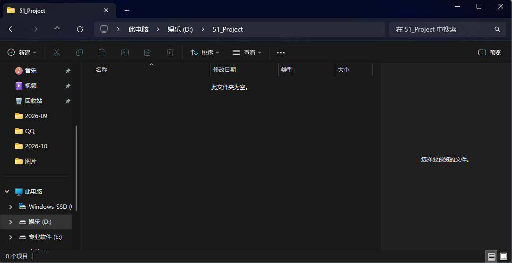

> **说明**：这个文件夹是"仓库"，以后所有 51 工程都放在这里，方便统一管理。

### 2.2 新建存放第一个工程的文件夹（图 2）

进入 `51_Project`，在里面再新建一个工程文件夹，命名为 `First_LED`（第一个 LED 工程）。

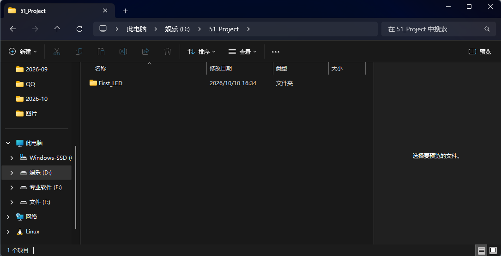

**为什么每个工程单独一个文件夹？** Keil 编译后会产生大量中间文件（`Objects`、`Listings` 等），一个工程一个文件夹，才能保证工程之间互不干扰、方便打包和迁移。

### 2.3 打开 Keil，新建工程（图 3）

打开 Keil uVision，点击菜单栏 **Project → New uVision Project...**。

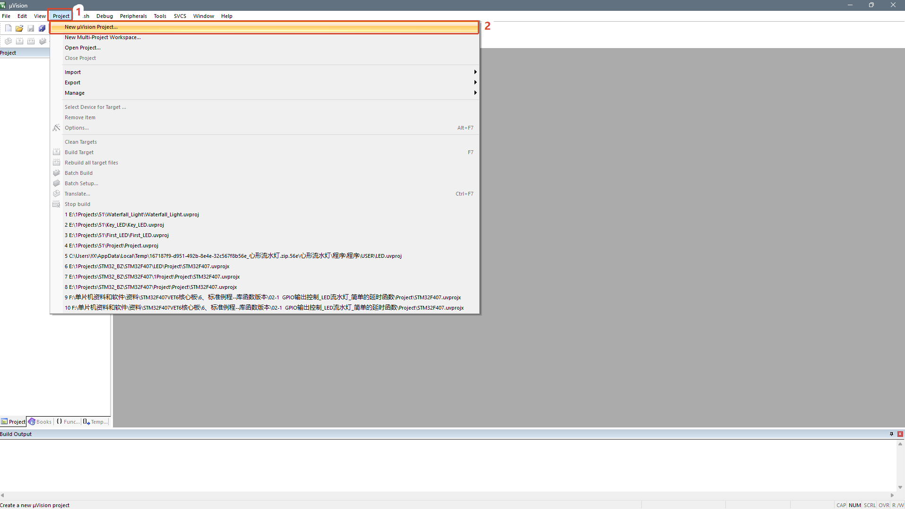

> **小技巧**：菜单最下方会列出最近打开过的工程，以后可以直接从那里快速打开。

### 2.4 选择工程位置并设置名称（图 4）

在弹出的对话框里：

1. 定位到刚才新建的文件夹 `D:\51_Project\First_LED`；
2. 文件名填 `First_LED`（工程名要和文件夹名保持一致，便于管理）；
3. 点击 **保存(S)**。

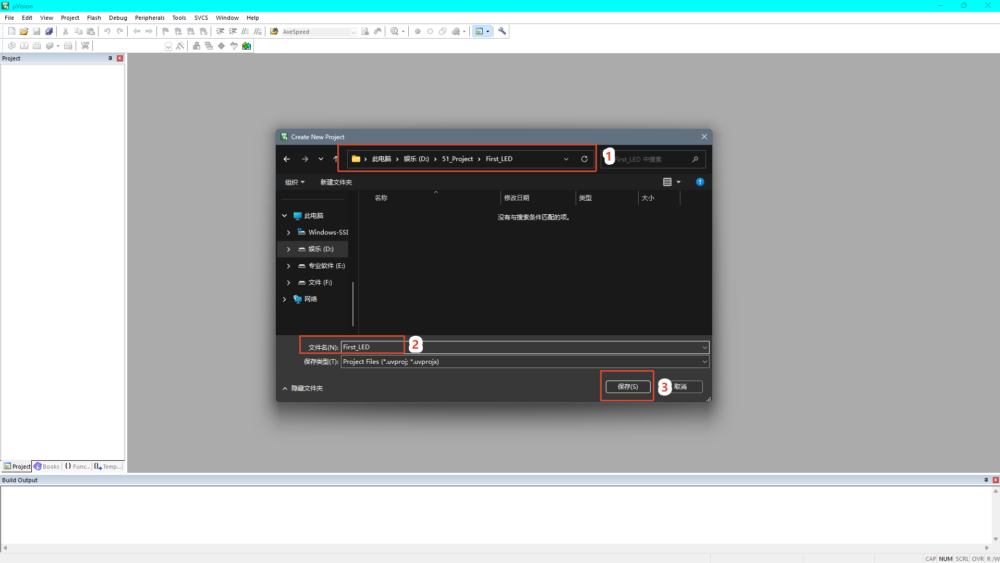

保存完成后，该文件夹里就会多出一个 `First_LED.uvproj` 工程文件。

### 2.5 选择芯片型号（图 5）

Keil 会弹出 **Select Device for Target** 对话框，按下面三步操作：

1. 确认左侧 **Vendor** 选择 `Legacy Device Database [no RTE]`（老器件库，51 单片机都在这里）；
2. 在 **Search** 框里输入 `AT89C52`；
3. 在下方列表选中 **Microchip → AT89C52**（右侧 Description 会显示它的资源说明），点击 **OK**。

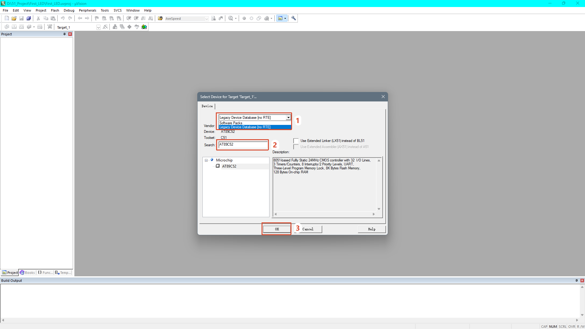

**为什么选 AT89C52，而不是 STC89C52？** Keil 官方器件库里没有 STC 的芯片。STC89C52RC 与 AT89C52 的内核、寄存器、引脚完全兼容，所以业界通用做法就是：**用 AT89C52 来编译 STC89C52 的程序**，生成的 HEX 可以直接下载运行。

### 2.6 添加启动文件 STARTUP.A51（图 6）

选择芯片后，Keil 会弹窗询问：

```text
Copy 'STARTUP.A51' to Project Folder and Add File to Project ?
```

点击 **是(Y)**。

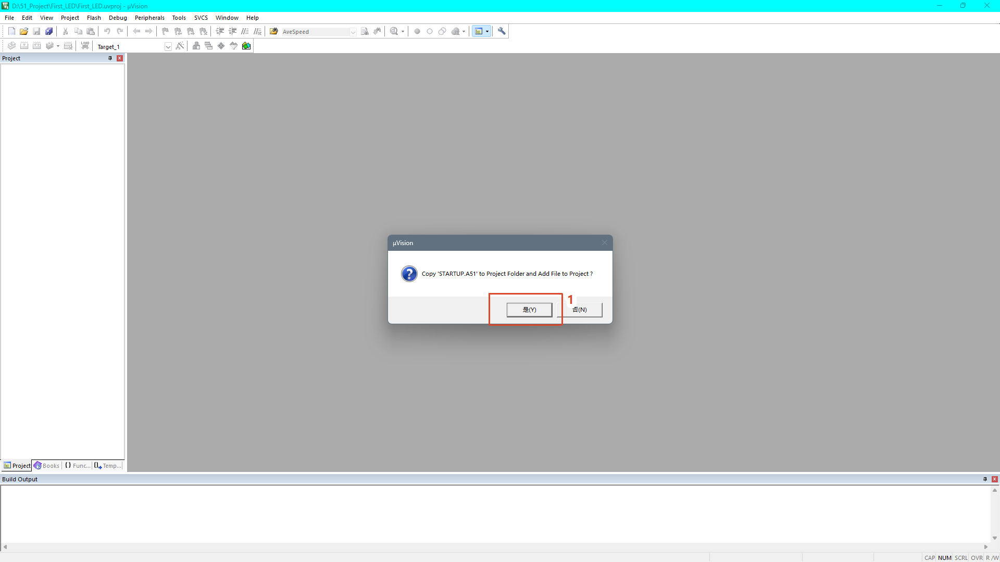

**STARTUP.A51 是什么？** 它是 C51 程序的启动代码（汇编语言）。单片机复位后，先执行它，由它负责清空 RAM、初始化堆栈指针，然后再跳转到我们写的 `main()` 函数。初学者直接默认添加即可，不要修改它。

至此，一个空的 Keil 工程就建好了，左侧 **Project** 窗口已经能看到 `Target 1 → Source Group 1 → STARTUP.A51`。

### 2.7 添加新的 .c 源文件（图 7）

我们还需要一个 C 语言源文件来写主程序：

1. 在左侧 Project 窗口，右键点击 **Source Group 1**（图中 ①）；
2. 在弹出的菜单中选择 **Add New Item to Group 'Source Group 1'...**（图中 ③）。

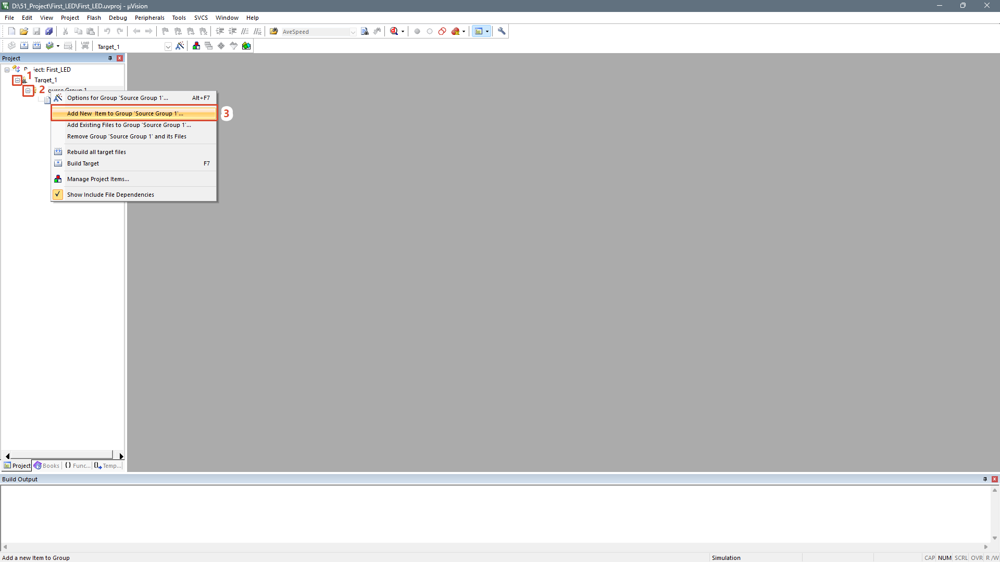

### 2.8 新建 main.c 文件（图 8）

在弹出的窗口中：

1. 左侧选择 **C File (.c)**（图中 ①）；
2. 右侧 **Name** 处填写 `main`（图中 ②，小写，不要写 `main.c`，Keil 会自动加扩展名）；
3. **Location** 确认为 `D:\51_Project\First_LED`；
4. 点击 **Add**，然后点 **Close**（图中 ③）。

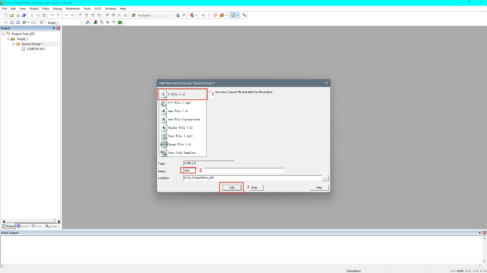

完成后，Project 窗口中会多出一个 `main.c`，编辑器里也会自动打开一个空白的代码编辑区。

### 2.9 勾选生成 HEX 文件（图 9）

**这一步非常关键，漏了就下载不了！** 因为 STC-ISP 只认 `.hex` 文件。

1. 点击工具栏上的**魔术棒图标**（Options for Target，图中 ①）；
2. 在弹出的窗口中切到 **Output** 选项卡（图中 ②）；
3. 勾选 **Create HEX File**（图中 ③），HEX Format 保持默认的 `80`；
4. 点击 **OK**（图中 ④）。

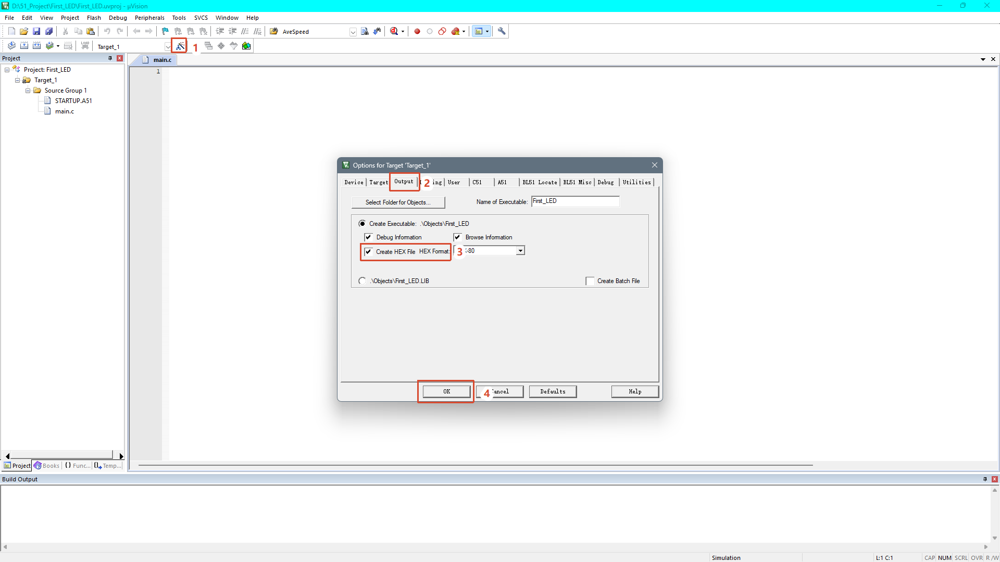

> **注意**：默认**不勾选**这个选项，这是新手最常见的"为什么找不到 hex 文件"的原因。

---

## 三、编写点亮 LED 的程序

### 3.1 输入代码（图 10）

双击左侧的 `main.c`，把下面这段代码完整输入进去：

```c
/*
 * 调用头文件
 */
#include "reg52.h"

/*
 * 引脚定义
 */
sbit LED1 = P2^0;
sbit LED2 = P2^1;
sbit LED3 = P2^2;
sbit LED4 = P2^3;
sbit LED5 = P2^4;
sbit LED6 = P2^5;
sbit LED7 = P2^6;
sbit LED8 = P2^7;

/**
 * @brief  主程序
 * @param  无
 * @retval 无
 */
int main(void)
{
    // LED 共阳极接法，引脚输出低电平产生电势差 --> LED 亮
    LED1 = 0;   // LED1 亮
    LED2 = 1;   // LED2 灭
    LED3 = 0;   // LED3 亮
    LED4 = 1;   // LED4 灭
    LED5 = 0;   // LED5 亮
    LED6 = 1;   // LED6 灭
    LED7 = 0;   // LED7 亮
    LED8 = 1;   // LED8 灭

    while(1)
    {
    }
}
```

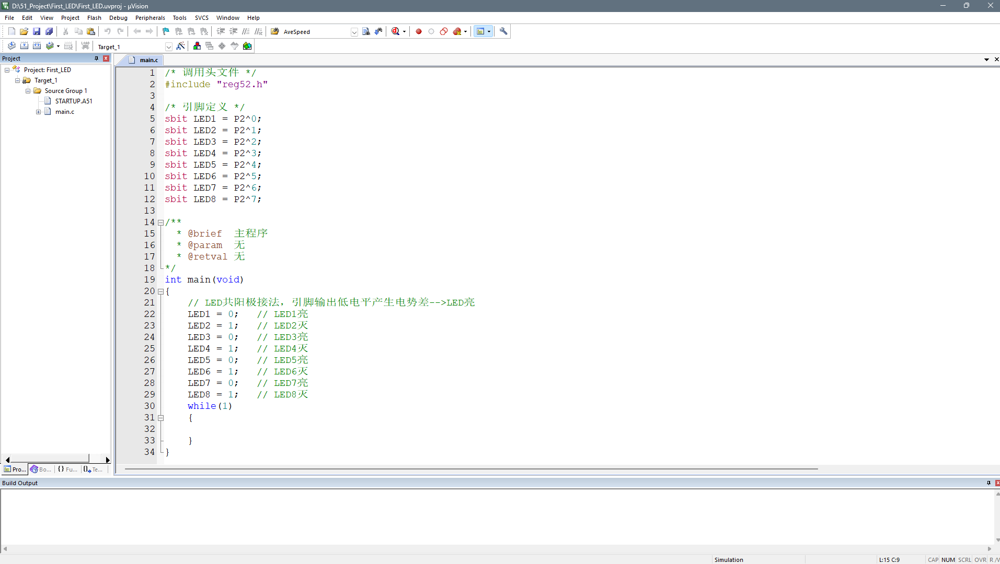

**这段程序做了什么？** 把开发板上 LED 模块的 8 个灯，按**亮、灭、亮、灭……**交替的方式点亮，即 **LED1、LED3、LED5、LED7 亮，LED2、LED4、LED6、LED8 灭**。详细原理见[第六章](#六代码原理详解)。

### 3.2 解决中文注释乱码（图 11）

输入中文注释后，如果发现注释变成乱码，说明 Keil 的编码格式和文件不匹配，按下面步骤修改：

1. 点击工具栏的 **Configuration** 图标（图中 ①，或菜单 **Edit → Configuration**）；
2. 切到 **Editor** 选项卡（图中 ②）；
3. 把 **Encoding** 下拉框改为 **Chinese GB2312 (Simplified)**（图中 ③）；
4. 点击 **OK**（图中 ④），乱码即可恢复正常。

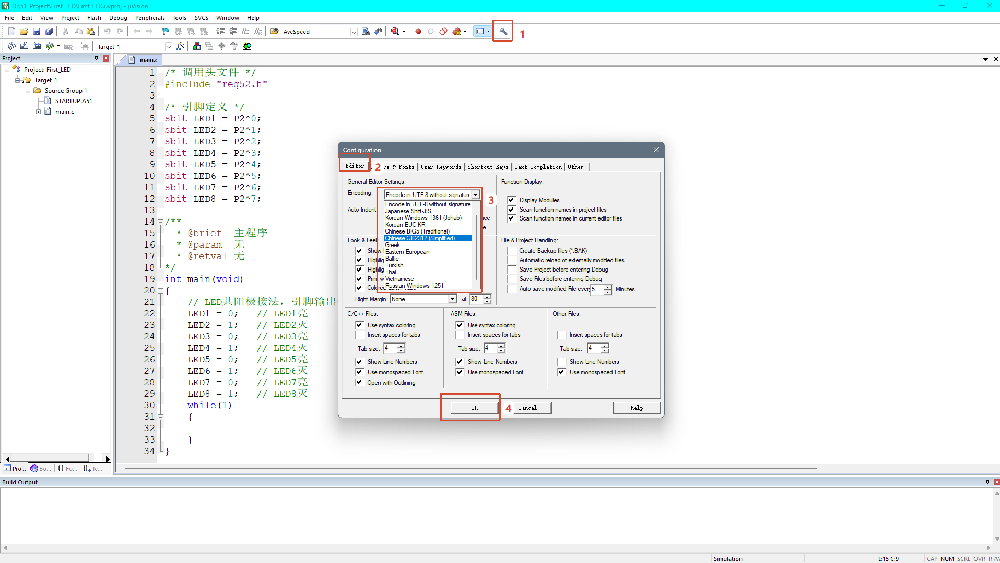

> **补充**：也可以选择 **Encode in UTF-8 without signature**。关键是**编码要和源文件实际编码一致**，修改后如果仍乱码，可先关掉文件再重新打开。

---

## 四、编译生成 HEX 文件

### 4.1 编译工程（图 12）

点击工具栏上的**编译按钮**（图中 ①，图标为向下箭头的编译/重新编译按钮），在弹出的下拉中可以选择 **Build (F7)** 或 **Rebuild all target files**。

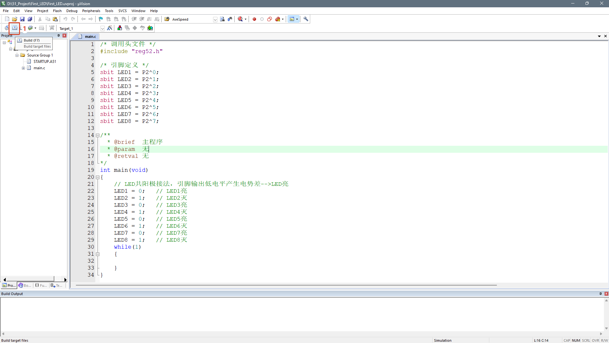

- **Build**：只编译改动过的文件，速度快，日常使用推荐；
- **Rebuild**：全部重新编译，适合排查疑难问题时使用。

### 4.2 确认编译成功（图 13）

编译完成后，看下方 **Build Output** 窗口：

```text
Build target 'Target_1'
linking...
Program Size: data=9.0 xdata=0 code=33
creating hex file from ".\Objects\First_LED"...
".\Objects\First_LED" - 0 Error(s), 0 Warning(s).
```

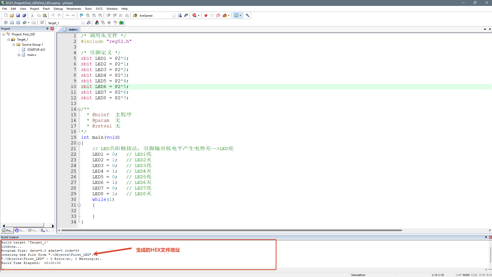

只要显示 `0 Error(s), 0 Warning(s)`，就说明编译成功，并且 HEX 文件已经生成。

图中箭头所指的 `creating hex file from ".\Objects\First_LED"` 就是 HEX 文件的生成位置。`code=33` 表示程序占用 33 字节的程序存储空间，`data=9.0` 表示占用的内部 RAM 字节数，数据很小，属正常现象。

### 4.3 在文件管理器中查看 HEX 文件（图 14）

打开工程文件夹，进入 `Objects` 目录，可以看到生成的 `First_LED.hex` 文件，这就是接下来要烧录的程序文件。

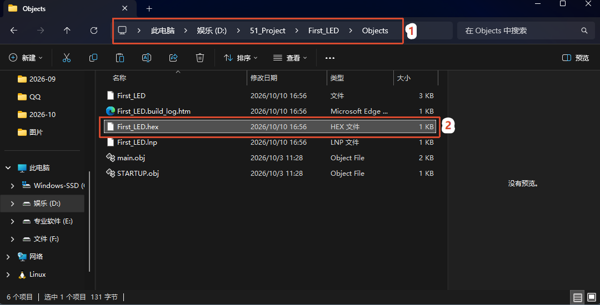

> **HEX 文件是什么？** 它是 Intel HEX 格式的文本文件，用 ASCII 字符记录了机器码和校验信息，STC-ISP 会读取它并写入单片机的程序存储器（Flash）。

---

## 五、用 STC-ISP 把程序下载到开发板

### 5.1 打开 STC-ISP 软件（图 15）

双击打开 STC-ISP 下载软件（本教程使用的是 V6.97C 版本）。

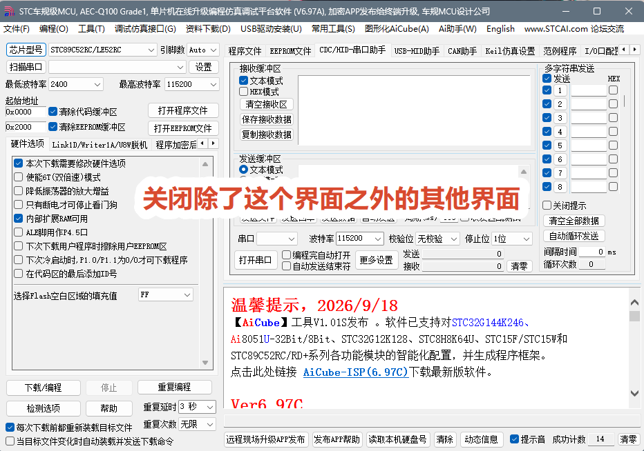

> **重要提示**：下载过程中，请**关闭除本软件外的其他串口类软件**（如图中提示），否则串口会被占用，导致下载失败。

### 5.2 设置芯片型号与串口号（图 16）

拿到开发板、用 USB 线连接到电脑后（此时开发板电源开关先保持关闭），在 STC-ISP 中设置：

1. **芯片型号**：选择 `STC89C52RC/LE52RC`（图中 ①，必须与实际板载芯片一致）；
2. **扫描串口**：选择对应的 COM 口（图中 ②，本机为 `COM4 (USB-SERIAL CH340)`，你的电脑 COM 号可能不同，以实际显示为准）；
3. 其他参数保持默认即可（波特率 115200、起始地址 0x0000 等）。

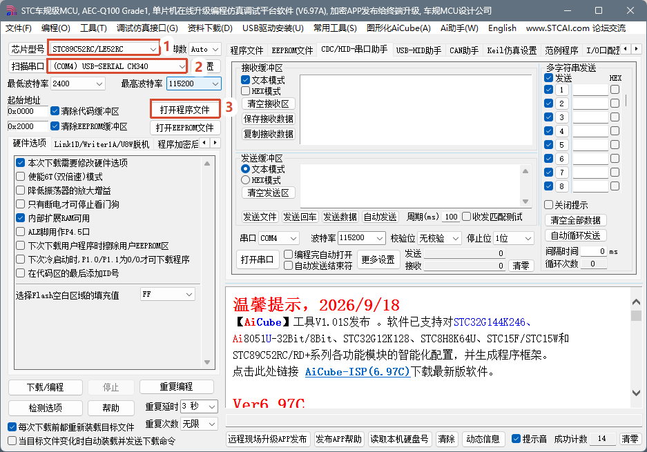

> **找不到串口怎么办？** 通常是 CH340 驱动没装，参见 [7.2 节](#72-stc-isp-找不到串口com-口)。
>
> **COM 口选错了会怎样？** 会一直提示"正在检测目标单片机"，无法下载。

### 5.3 打开要下载的 HEX 文件（图 17）

1. 点击左侧的**打开程序文件**按钮（图中 ①）；
2. 在文件选择框中，定位到 `D:\51_Project\First_LED\Objects`（图中 ②）；
3. 选中 `First_LED.hex`（图中 ③）；
4. 点击**打开(O)**（图中 ④）。

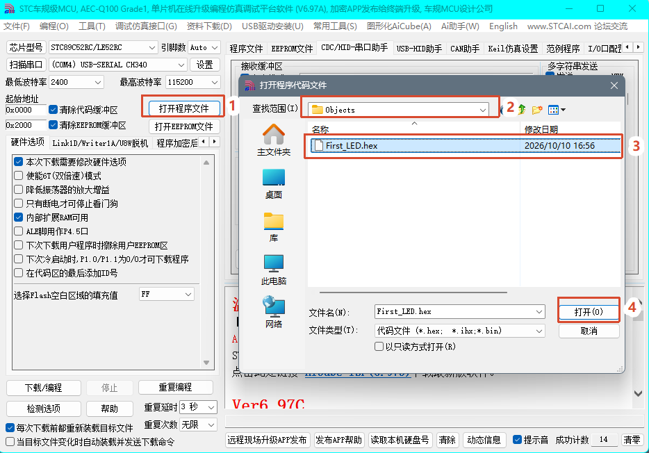

打开成功后，右侧的代码编辑区会显示 HEX 文件内容（一堆十六进制数字），下方会显示**代码长度**等信息，说明文件已正确加载。

### 5.4 连接开发板并保持断电（图 18）

用 USB 线把普中 A2 开发板连接到电脑，**此时开发板电源开关保持关闭（断电状态）**。

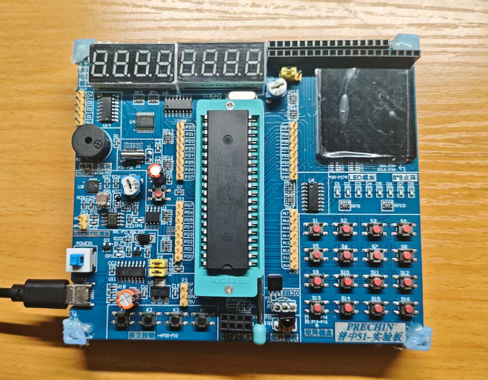

**为什么必须"先断电"？** STC 系列单片机通过串口下载，只有**冷启动（断电后重新上电）**时，单片机内部的 ISP 监控程序才会接管串口等待下载命令。所以必须在"点击下载"之后再给板子上电。这一步叫**冷启动下载**。

### 5.5 点击下载，检测单片机（图 19）

点击左侧的**下载/编程**按钮（图中 ①），STC-ISP 开始等待单片机响应，此时右侧提示 **"正在检测目标单片机 ..."**（图中 ②）。

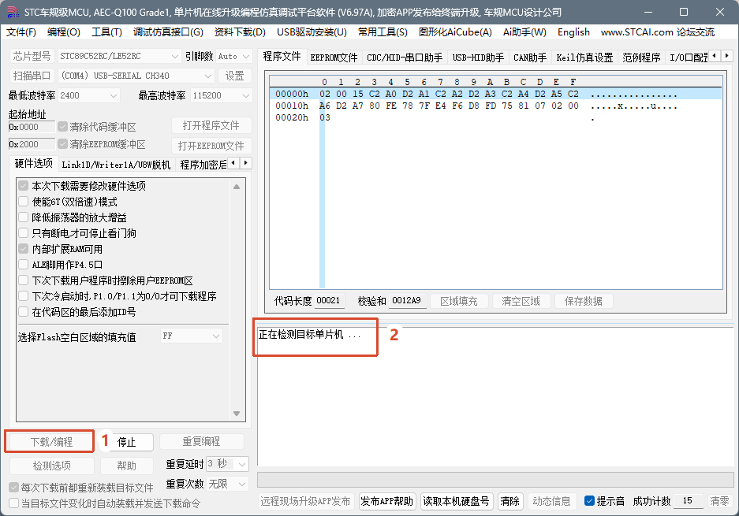

### 5.6 给开发板上电（图 20）

在软件显示"正在检测目标单片机 ..."的状态下，**打开开发板的电源开关**（冷启动）。

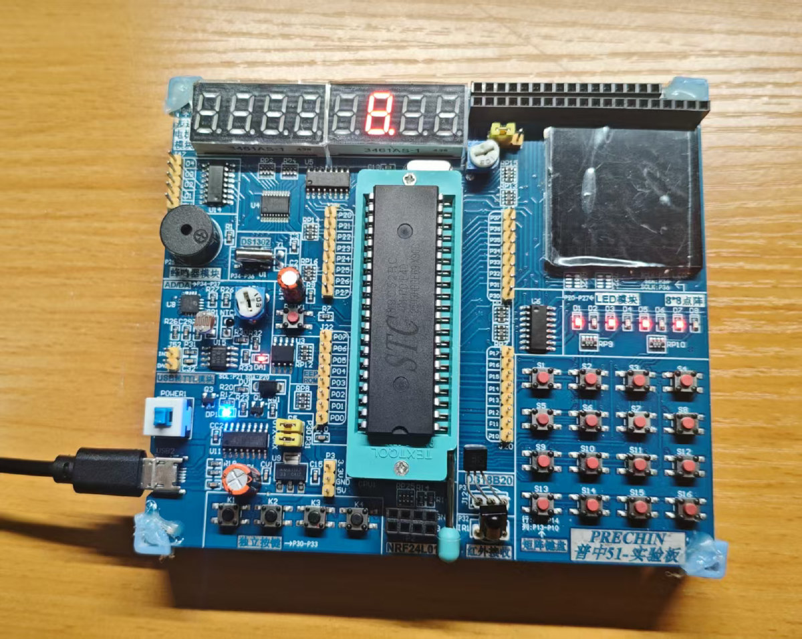

上电瞬间，单片机复位并运行 ISP 监控程序，STC-ISP 立即与它握手成功，随即开始下载。

### 5.7 下载成功（图 21）

稍等片刻，STC-ISP 会显示：

```text
单片机型号: STC89C52RC/LE52RC
操作成功！
```

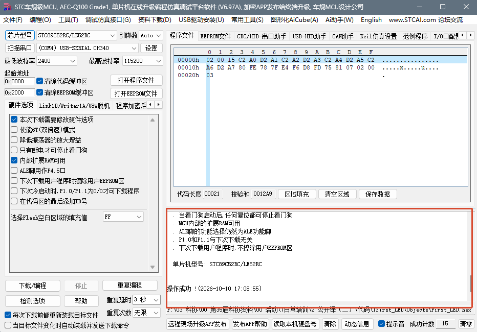

出现 **"操作成功！"** 即代表程序已经烧录进单片机。

### 5.8 观察实验结果（图 22）

下载完成后程序自动运行。观察开发板右侧的 **LED 模块**，可以看到：

- **D1、D3、D5、D7 四个灯点亮**；
- **D2、D4、D6、D8 四个灯不亮**。

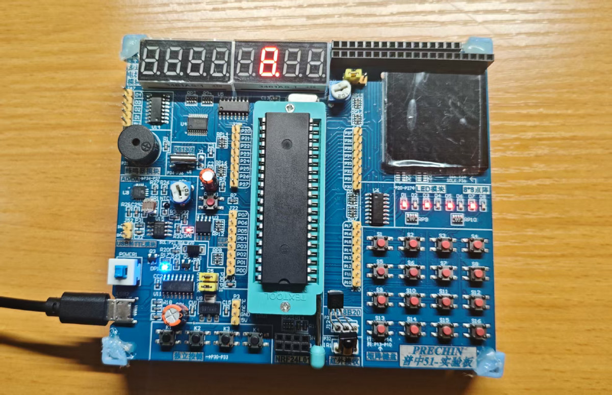

这与程序中 `LED1/3/5/7 = 0`、`LED2/4/6/8 = 1` 的设定完全一致，实验成功！🎉

至此，你已完成了一次完整的 **"写代码 → 编译 → 烧录 → 运行"** 闭环，这就是单片机开发的基本工作流。

---

## 六、代码原理详解

我们把程序拆成 4 个部分来理解。

### 6.1 头文件

```c
#include "reg52.h"
```

`reg52.h` 是 Keil C51 自带的**寄存器定义头文件**。它声明了 51 单片机内部所有特殊功能寄存器（如 `P0`、`P1`、`P2`、`P3`、`TMOD`、`TCON` 等）的地址。包含它之后，我们才能直接在代码里用 `P2` 这样的名字去操作硬件，否则编译器根本不认识这些名字。

### 6.2 位定义（sbit）

```c
sbit LED1 = P2^0;
sbit LED2 = P2^1;
...
```

`sbit` 是 C51 特有的**位寻址**关键字，作用是给**某一个引脚**取一个别名。

`P2^0` 表示 P2 寄存器的**第 0 位**，也就是单片机的 **P2.0 引脚**。

执行 `sbit LED1 = P2^0;` 后，写 `LED1 = 0;` 就等价于把 P2.0 引脚输出低电平。

开发板上 LED 模块的 D1~D8 正好分别接在单片机的 **P2.0~P2.7** 上，所以一一对应。

### 6.3 主函数与引脚赋值

```c
int main(void)
{
    LED1 = 0;   // P2.0 输出低电平
    LED2 = 1;   // P2.1 输出高电平
    ...
}
```

**为什么"输出低电平灯就亮"？** 看普中开发板的 LED 电路接法：

```text
        +5V
         │
      [限流电阻]
         │
  ┌──────┴────── LED 阳极
  │
 LED 阴极
  │
P2.x 引脚（单片机）
```

这是**共阳极接法**（所有 LED 的阳极公共接到 +5V）：

| 引脚输出 | 引脚电压 | LED 两端压差 | 结果 |
| --- | --- | --- | --- |
| 0（低电平） | 0 V | 5 V − 0 V = 5 V，有压差 | 有电流流过，灯亮 ✅ |
| 1（高电平） | 5 V | 5 V − 5 V = 0 V，无压差 | 无电流，灯灭 ⭕ |

所以程序中 `LED1 = 0` 灯亮、`LED2 = 1` 灯灭，交替点亮，形成"隔一个亮一个"的效果。

> **补充知识**：51 单片机复位后，P0~P3 口默认全部输出**高电平**，因此上电时 LED 默认是全灭的。

### 6.4 死循环

```c
while(1)
{
}
```

`while(1)` 是一个**永远为真**的循环，程序执行到这里就会一直停在这里空转。

**为什么必须有它？** 单片机程序不允许"执行完就结束"。如果 `main` 函数执行完返回，单片机会继续往下执行 Flash 中的随机内容，导致程序跑飞、失控。用 `while(1)` 把程序"钉"在这里，是单片机程序的标准写法。

以后的实验里，我们通常把主要功能代码放在这个循环里，让它**反复执行**，例如流水灯、按键扫描、数码管动态刷新等。

---

## 七、常见问题与解决方法

### 7.1 Keil 编译相关问题

#### 问题 1：编译报错 `Target not created`

- **现象**：Build Output 显示 `Target not created`，且上方有一堆 `error Cxxx`。
- **原因**：代码有语法错误，编译不通过。
- **解决**：
  1. 在 Build Output 窗口中双击第一条 `error`，Keil 会自动跳转到出错的那一行；
  2. 逐条修改错误（**只需关注第一条 error**，后面的错误往往是连锁反应）；
  3. 常见低级错误：
     - 语句末尾漏写分号 `;`；
     - 括号 `{}`、`()` 不配对；
     - 中文标点写成英文半角（如 `；`、`（`、`"`），这是新手最容易踩的坑；
     - 变量名拼写错误、大小写不一致（C 语言**区分大小写**）。
  4. 修改后重新编译，直到错误数变成 `0 Error(s)`。

#### 问题 2：编译成功，但找不到 `.hex` 文件

- **现象**：显示 `0 Error(s)`，但 `Objects` 文件夹里没有 `.hex`。
- **原因**：忘记勾选"生成 HEX 文件"选项。
- **解决**：按 [2.9 节](#29-勾选生成-hex-文件图-9)重新勾选 **Create HEX File**，再次编译即可。

#### 问题 3：中文注释显示为乱码

- **解决**：按 [3.2 节](#32-解决中文注释乱码图-11)把 **Encoding** 改为 **Chinese GB2312 (Simplified)**。

> 建议一开始就统一设置好编码，避免以后所有工程都乱码。

#### 问题 4：在芯片库里找不到 STC89C52

- **原因**：Keil 官方器件库确实没有 STC 系列。
- **解决**：这不是问题，直接选 `AT89C52` 即可（见 [2.5 节](#25-选择芯片型号图-5)），二者完全兼容，生成的 HEX 可以直接下载到 STC89C52 中运行。

#### 问题 5：工具栏的编译按钮是灰色、点不了

- **原因**：没有打开任何工程文件。
- **解决**：通过 **Project → Open Project** 打开 `.uvproj` 工程文件后再操作。

### 7.2 STC-ISP 找不到串口（COM 口）

- **现象**：STC-ISP 的"扫描串口"下拉框里是空的，或者只有 `COM1` 之类的物理串口，找不到 `USB-SERIAL CH340`。
- **原因与解决**（按可能性从高到低排查）：
  1. **CH340 驱动未安装**（最常见）→ 安装开发板配套资料里的 CH340 驱动，或到沁恒官网下载安装。装完驱动后重新插拔 USB 线，设备管理器的"端口(COM 和 LPT)"中会出现 `USB-SERIAL CH340 (COMx)`。
  2. **USB 线是"充电线"** → 部分 USB 线只有电源线没有数据线。换一根确认能传数据的线。
  3. **USB 口接触不良 / 供电不足** → 换一个 USB 口（优先用电脑机箱后面板的 USB 口）。
  4. **驱动装好但显示黄色感叹号** → 右键设备 → 卸载设备 → 重新插拔，让系统重新安装驱动。

### 7.3 一直提示"正在检测目标单片机 ..."

- **现象**：点击"下载/编程"后，软件始终停在"正在检测目标单片机 ..."，无法下载。
- **原因与解决**：
  1. **没有冷启动**（最常见）→ 必须在点击下载**之后**，给开发板**断电再上电**（关一下电源开关再打开）。STC 单片机只在冷启动瞬间才会进入下载模式。
  2. **COM 口选错** → 重新确认 [5.2 节](#52-设置芯片型号与串口号图-16)中选择的是板子实际对应的 COM 口。
  3. **芯片型号选错** → 确认选的是 `STC89C52RC/LE52RC`，与实际板载芯片一致。
  4. **串口被其他软件占用** → 关闭串口助手、其他 STC-ISP 窗口、调试软件等一切占用串口的程序，然后重新插拔 USB 线再试。
  5. **开发板电源开关没打开** → 检查板上电源指示灯是否亮起。
  6. **降低最高波特率** → 把"最高波特率"从 115200 调低到 9600 或 4800，提高握手成功率。

### 7.4 下载提示"操作成功"，但 LED 没反应

- **现象**：STC-ISP 显示"操作成功！"，但开发板上灯不亮，或现象与预期不符。
- **排查步骤**：
  1. **确认下载的 HEX 是最新的** → 每次改了代码，必须重新编译（生成新的 HEX），再在 STC-ISP 里重新打开一次 HEX 文件。注意：STC-ISP 不会自动读取更新后的文件（除非勾选了"当目标文件变化时自动装载并发送下载命令"）。
  2. **确认开发板已进入运行状态** → 按一下开发板的复位按键，让新程序从头运行。
  3. **检查程序里的引脚是否写对** → 本实验 LED 接在 P2 口，若代码写成 P1、P0 则灯不会亮。
  4. **检查是否误下载了旧程序** → 在 STC-ISP 中重新"打开程序文件"，选择 `Objects\First_LED.hex`。
  5. **确认 LED 模块的跳线帽** → 部分普中开发板的 LED 模块有跳线帽/拨码开关，需要短接到 P2 口那一侧。

### 7.5 其他常见问题速查表

| 现象 | 可能原因 | 解决方法 |
| --- | --- | --- |
| 双击 `.uvproj` 打不开 | Keil 未正确安装或文件关联丢失 | 打开 Keil → Project → Open Project 手动选择 |
| 编译提示 `requires ANSI-style prototype` | 函数调用前未声明 | 把函数定义写在调用之前，或在文件开头加函数声明 |
| 下载后开发板数码管乱亮 | 程序未初始化数码管，属正常现象 | 本实验只关心 LED，忽略数码管即可 |
| 电脑识别不到 USB 设备 | 线材/接口问题 | 换线、换 USB 口，重装 CH340 驱动 |
| 换电脑后无法下载 | 新电脑没装 Keil / CH340 驱动 | 在新电脑上重新安装对应软件与驱动 |
| 单片机发烫 | 芯片插反或供电异常 | **立即断电**，检查单片机方向（缺口/圆点对准底座缺口） |

---

## 八、全流程回顾

最后用一张流程图回顾整个流程，方便以后独立操作时对照：

```text
① 新建工程文件夹（如 First_LED）
   ↓
② Keil：Project → New uVision Project → 放到该文件夹并命名
   ↓
③ 选择芯片：AT89C52（兼容 STC89C52RC）
   ↓
④ 弹出提示点"是" → 添加 STARTUP.A51 启动文件
   ↓
⑤ 右键 Source Group 1 → Add New Item → 新建 main.c
   ↓
⑥ 魔术棒 → Output → 勾选 Create HEX File
   ↓
⑦ 在 main.c 中编写程序
   ↓
⑧ 点击编译（Build / F7）→ 确认 0 Error(s)
   ↓
⑨ 在 Objects 文件夹找到 First_LED.hex
   ↓
⑩ STC-ISP：选芯片型号 STC89C52RC + 对应 COM 口
   ↓
⑪ 打开程序文件 → 选择 First_LED.hex
   ↓
⑫ 点"下载/编程" → 开发板冷启动（断电再上电）
   ↓
⑬ 提示"操作成功！" → LED 点亮 🎉
```

记住这套流程，它就是 51 单片机开发的"标准动作"。之后学习数码管、按键、中断、定时器等，都只是在**第 ⑦ 步更换代码**而已。
