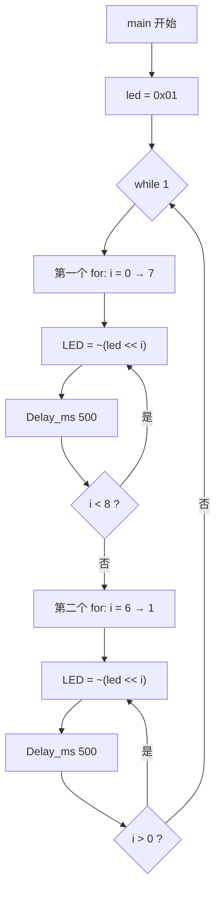

# 第 2 讲：流水灯

> **配套例程**：[51_Project/2Waterfall_Light](../51_Project/2Waterfall_Light/)
>
> **面向读者**：自动化与信息工程学院学生科学与技术协会大一成员
>
> **硬件平台**：普中 A2 开发板（主控 STC89C52RC，11.0592 MHz 晶振）
>
> **前置要求**：已完成[第 1 讲](01_Keil新建工程与程序下载.md)，能用 Keil 新建工程、编译并用 STC-ISP 下载程序；了解 C 语言的基本语法。

上一讲我们点亮了 LED，但程序从上电到结束只执行一次，灯的状态再也不会变化。这一讲要让 LED **动起来**——8 个 LED 依次点亮，再从另一头依次亮回来，形成来回流动的"瀑布灯"。

## 目录

- [写在前面](#写在前面)
- [关于普中 A2](#关于普中-a2)
- [基础知识](#基础知识)
  - [数制：位、字节与十六进制](#数制位字节与十六进制)
  - [sfr 与 sbit：端口怎么变成代码里的名字](#sfr-与-sbit端口怎么变成代码里的名字)
  - [晶振、时钟周期与机器周期](#晶振时钟周期与机器周期)
  - [intrins.h 与 _nop_()](#intrinsh-与-_nop_)
- [Waterfall_Light：8 位流水灯](#waterfall_light8-位流水灯)
  - [硬件电路](#硬件电路)
  - [完整代码](#完整代码)
  - [逐句讲解](#逐句讲解)
  - [Delay_ms 的真相](#delay_ms-的真相)
  - [完整状态表](#完整状态表)
- [小结](#小结)

---

## 写在前面

### 这份教程怎么用

建议你对着 Keil 打开配套工程，一边看代码一边读——**光看不敲是学不会单片机的**。

每个知识点后面如果标了 **⚠**，说明这是初学者最容易踩的坑。

> 📁 本讲完整代码已收录在本仓库：[51_Project/2Waterfall_Light](../51_Project/2Waterfall_Light/)
>
> 可直接用 Keil 打开 `.uvproj` 编译烧录。

---

## 关于普中 A2

普中 A2 上的关键硬件：

| 模块 | 连接方式 | 本讲是否用到 |
| --- | --- | --- |
| 8 个 LED | 接 **P2.0 ~ P2.7**，共阳极，低电平点亮 | ✅ |
| 4 个独立按键 | K1→P3.1、K2→P3.0、K3→P3.2、K4→P3.3，另一端接 GND | 下一讲使用 |
| 晶振 | 11.0592 MHz | ✅ |

> ⚠ **LED 与数码管模块共用 P2 口。** 如果烧录后 LED 不亮或出现异常，先检查板子上相关跳线是不是接在 LED 一侧——这是新手最常见的"代码没错但灯不亮"的原因。

---

## 基础知识

### 数制：位、字节与十六进制

- **位（bit）**：最小的单位，只能是 `0` 或 `1`。物理上对应一根引脚上的电压：低电平约 0 V 记为 `0`，高电平约 5 V 记为 `1`。
- **字节（byte）**：8 个位绑在一起。书写时从右往左编号，最右边是第 0 位（最低位），最左边是第 7 位（最高位）：

```text
位编号:   7    6    5    4    3    2    1    0
          │    │    │    │    │    │    │    │
二进制:   1    0    0    0    0    0    0    1
```

- **十六进制（Hex）**：二进制写起来太长，所以每 4 个二进制位压缩成 1 个十六进制数字。4 位正好 16 种组合，所以用 `0~9` 和 `A~F` 共 16 个符号：

| 二进制 | 十六进制 | 二进制 | 十六进制 |
| --- | --- | --- | --- |
| 0000 | 0 | 1010 | A (10) |
| 0001 | 1 | 1011 | B (11) |
| 0010 | 2 | 1100 | C (12) |
| 0011 | 3 | 1101 | D (13) |
| 0100 | 4 | 1110 | E (14) |
| 0101 | 5 | 1111 | F (15) |
| 0110 | 6 | | |
| 0111 | 7 | | |
| 1000 | 8 | | |
| 1001 | 9 | | |

在 C 语言里，`0x` 开头表示十六进制，直接写数字是十进制。`0x` 和 `0X` 完全等价。

两个项目里会反复出现的关键常量，先记住它们的二进制长相：

| 十六进制 | 二进制 | 含义 |
| --- | --- | --- |
| `0x01` | 0000 0001 | 只有第 0 位是 1 |
| `0x02` | 0000 0010 | 只有第 1 位是 1 |
| `0x80` | 1000 0000 | 只有第 7 位是 1 |
| `0xFE` | 1111 1110 | 只有第 0 位是 0 |
| `0x7F` | 0111 1111 | 只有第 7 位是 0 |
| `0xFF` | 1111 1111 | 全部是 1 |

### sfr 与 sbit：端口怎么变成代码里的名字

工程的第一行都是：

```c
#include "reg52.h"
```

`reg52.h` 是 Keil 自带的头文件。它本身**不包含任何函数**，只做一件事：给单片机的每个端口和寄存器取一个 C 语言里能用的名字。

打开 `reg52.h`，你会看到大致这样的内容：

```c
sfr P0 = 0x80;
sfr P1 = 0x90;
sfr P2 = 0xA0;
sfr P3 = 0xB0;
/* ……还有很多 */
```

`reg52.h` 里的 `sfr` 就是 Keil C51 特有的关键字（标准 C 语言里没有），含义是：告诉编译器"`P2` 这个名字代表地址 `0xA0` 处的那个 8 位硬件寄存器，不要另外给它分配内存"。

所以 `P2 = 0xFE;` 编译出来就是一条写 `0xA0` 地址的指令，直接作用到硬件上——你可以把它理解成"把 P2 这一排 8 个开关拨成 `1111 1110`"。

`sbit` 同样是 Keil C51 特有的关键字，用来给端口中的**某一位**单独取名字：

```c
sbit LED1 = P2^0;
```

这句话的意思是：`LED1` 代表 `P2` 的第 0 位（也就是引脚 `P2.0`）。

> ⚠ **这里的 `^` 不是异或**
>
> 在标准 C 语言里 `^` 是按位异或运算符。但在 `sbit` 定义语句里，Keil C51 把它特殊解释为"位选择"，语法是 `sbit 名字 = 端口名^位号;`。
>
> 也可以直接写位地址：`sbit LED1 = 0xA0;`（P2.0 的位地址就是 0xA0）。
>
> 只有地址能被 8 整除的寄存器才能位寻址。`P0`（0x80）、`P1`（0x90）、`P2`（0xA0）、`P3`（0xB0）都满足，所以都可以用 `sbit`。
>
> `sbit` 定义的东西只能放在函数外面（全局作用域），也不能在运行时改变指向哪一位。

本讲只控制整个 P2 端口，所以用的是 `#define LED P2`；下一讲要单独控制某一位，会大量使用 `sbit`。

### 晶振、时钟周期与机器周期

**晶振**是单片机的心跳。普中 A2 上焊的是 **11.0592 MHz** 的晶振，它产生固定频率的方波，单片机所有动作都踩着这个节拍进行。

```text
       ┌───┐   ┌───┐   ┌───┐
  ─────┘   └───┘   └───┘   └────  ← 晶振输出的方波
       ↑   ↑   ↑   ↑   ↑   ↑
```

一个"时钟周期" = 1 / 晶振频率。

三个概念层层递进：

| 概念 | 定义（标准 51 内核） | 普中 A2（11.0592 MHz） |
| --- | --- | --- |
| 时钟周期 | 晶振输出一个完整方波的时间 | 1 ÷ 11 059 200 ≈ **0.0904 μs** |
| 机器周期 | 12 个时钟周期，单片机执行一条基本操作的时间 | 12 ÷ 11 059 200 ≈ **1.0851 μs** |
| 指令周期 | 1 ~ 4 个机器周期（不同指令不一样） | — |

**"12 个时钟周期 = 1 个机器周期"是标准 51 内核的铁律**，后面所有时间计算都基于这条。

那么，1 毫秒需要多少个机器周期？

```text
1 ms = 1000 μs
1000 μs ÷ 1.0851 μs/机器周期 ≈ 921.4 个机器周期
```

这就是代码注释里"921 个机器周期约为 1 ms"的出处——这个换算本身是正确的。

**为什么偏偏选 11.0592 MHz 这个奇怪的数字？** 因为它是串口通信的经典频率。51 的串口波特率由定时器产生，用 11.0592 MHz 可以整除出 9600、19200 等标准波特率而不产生误差；换成 12 MHz 会有约 8.5% 的误差，串口通信会出错。所以开发板普遍用 11.0592 MHz。

> ⚠ 顺带一提：Keil 工程文件 `.uvproj` 里写的是 `<Cpu>...CLOCK(24000000)</Cpu>`，这个 24 MHz 只是 Keil 软件仿真时假装的频率，和你板子上的真实晶振无关。你的板子就是 11.0592 MHz。

### intrins.h 与 _nop_()

工程的第三行是：

```c
#include <intrins.h>    // 提供 _nop_() 函数
```

`intrins.h` 是 Keil 提供的**内部函数**头文件。所谓内部函数，就是**编译器直接把它翻译成一条汇编指令**，而不是真的去调用一个函数（没有函数调用开销，速度极快）。

里面常用的有：

| 函数 | 作用 | 对应汇编 |
| --- | --- | --- |
| `_nop_()` | 空操作，什么也不做，消耗 1 个机器周期 | NOP |
| `_crol_(x, n)` | 把 x 循环左移 n 位（移出去的高位补到低位） | RL 系列 |
| `_cror_(x, n)` | 循环右移 | RR 系列 |
| `_testbit_(x)` | 测试某位并清零 | JBC |

`_nop_()` 存在的意义：单片机执行指令需要时间，而 **NOP（No Operation）是一条什么都不做、但确确实实要花 1 个机器周期**的指令。所以可以用它来"磨时间"，精确地制造短延时。

> ⚠ **两个要点**
>
> 1. `_nop_()` 是内部函数，编译器**不会把它优化掉**——即使它看起来"什么也没做"。（如果写成空循环 `for(j=110;j>0;j--);`，某些编译器会把整个循环优化没，延时直接失效。）
> 2. NOP 是一条指令，而一条指令至少占 1 个机器周期，所以 `_nop_()` **精确等于 1 个机器周期**，没有歧义。

---

## Waterfall_Light：8 位流水灯

**功能**：8 个 LED 从 LED1 依次亮到 LED8，再从 LED7 依次亮回 LED2，如此循环往复，形成"来回流动"的视觉效果。

### 硬件电路

先看板子上的 LED 电路——这是理解后面移位、取反的前提。

#### LED 电路：为什么低电平点亮

LED（发光二极管）是有极性的器件：长脚是**阳极（+）**，短脚是**阴极（−）**。电流只能从阳极流向阴极，方向反了不亮。

普中 A2 上是**共阳极接法**：

```text
                        +5V
                         │
     ┌───┬───┬───┬───┬───┬───┬───┬───┐
     │   │   │   │   │   │   │   │   │
    ─┴─ ─┴─ ─┴─ ─┴─ ─┴─ ─┴─ ─┴─ ─┴─     8 个 LED（阳极统一接 +5V）
    ─┬─ ─┬─ ─┬─ ─┬─ ─┬─ ─┬─ ─┬─ ─┬─
     │   │   │   │   │   │   │   │
    [R] [R] [R] [R] [R] [R] [R] [R]     470 Ω 限流电阻
     │   │   │   │   │   │   │   │
   P2.0 P2.1 P2.2 P2.3 P2.4 P2.5 P2.6 P2.7
    LED1 LED2 LED3 LED4 LED5 LED6 LED7 LED8
```

所有 LED 的阳极统一接 +5 V，阴极各经过一个限流电阻接到 P2.0 ~ P2.7。于是：

| 引脚电平 | LED 状态 | 对应 P2 位 |
| --- | --- | --- |
| 低（0 V） | 亮（电流从 5 V 经 LED 流向引脚） | 0 |
| 高（5 V） | 灭（两端都是 5 V，无压差） | 1 |

所以 `P2.0 = 0` 点亮 LED1，`P2.0 = 1` 熄灭 LED1。这就是"低电平点亮"的由来。

#### 限流电阻：470 Ω 是怎么来的

LED 是二极管，导通后两端压降基本固定（红色 LED 约 1.8 ~ 2.2 V），剩下的电压必须由电阻承担，否则电流会无限大把 LED 烧掉。用欧姆定律：

```text
R = (VCC − V_LED) ÷ I
  = (5 V − 2 V) ÷ I
```

普中 A2 上选用的是 **470 Ω**，反推电流：

```text
I = (5 − 2) ÷ 470 ≈ 6.4 mA
```

这个电流对普通 LED 足够亮，又远低于 LED 的额定电流（通常 20 mA），安全余量充足。

> ⚠ **限流电阻绝对不能省。** 没有它，LED 两端直接承受 5 V，电流会远超额定值，LED 会在很短时间内发烫、变暗、永久损坏。

#### 灌电流 vs 拉电流：为什么不能反过来接

单片机引脚有两种驱动方式：

- **灌电流（Sink）**：引脚输出低电平，电流从外部电源**流进**引脚再到 GND。P1/P2/P3 口约能承受 **10 ~ 20 mA**。
- **拉电流（Source）**：引脚输出高电平，电流从引脚**流出**到外部器件。51 的拉电流能力**非常弱**，只有几百微安。

**结论**：51 单片机更适合灌电流接法，也就是"共阳极 + 低电平点亮"——这正是普中 A2 的设计。

如果反过来接成共阴极（LED 阳极接引脚，高电平点亮），每个 LED 都要靠引脚"拉电流"驱动，很可能亮度极低甚至完全不亮。

这就是为什么所有 51 教程都会说"LED 低电平点亮"——**这不是习惯，是芯片硬件特性决定的。**

### 完整代码

文件：[51_Project/2Waterfall_Light/main.c](../51_Project/2Waterfall_Light/main.c)

```c
/*
 * 调用头文件
 */
#include "reg52.h"
#include <intrins.h>    // 提供 _nop_() 函数

/*
 * 引脚端口宏定义
 */
// LED 接在 P20 -- P27 引脚，即 P2 端口
#define LED P2

// 函数声明
void Delay_ms(unsigned int ms);

/**
 * @brief  主函数
 * @param  无
 * @retval 无
 */
int main(void)
{
    unsigned char i, led;
    led = 0X01;             // 0000 0001，作为移位的基础
    while(1)
    {
        // LED1 -> LED8（左移）
        for(i = 0; i < 8; i++)
        {
            LED = ~(led << i);
            Delay_ms(500);  // 保证每个 LED 点亮 500ms
        }
        // LED7 -> LED2（右移）（避免两头 LED 重复点亮）
        for(i = 6; i > 0; i--)
        {
            LED = ~(led << i);
            Delay_ms(500);  // 保证每个 LED 点亮 500ms
        }
    }
}

/**
 * @brief  延时函数：产生一段时间的延时效果
 * @param  ms 想要产生延时的毫秒数
 * @retval 无
 */
void Delay_ms(unsigned int ms)
{
    unsigned int i, j;
    for(i = ms; i > 0; i--)
    {
        // 11.0592MHz 晶振，921 个机器周期约为 1ms
        for(j = 110; j > 0; j--)
        {
            _nop_();    // 空操作，消耗 1 个机器周期
        }
    }
}
```

### 逐句讲解

#### 端口宏定义（第 5 ~ 7 行）

```c
/*
 * 引脚端口宏定义
 */
// LED 接在 P20 -- P27 引脚，即 P2 端口
#define LED P2
```

**`#define` 是什么？** `#define` 是**预处理宏定义**，在编译之前由**预处理器**做纯文本替换。这句话的意思是："从这一行开始，代码里每次出现 `LED` 这个词，都原样替换成 `P2`"。

所以：

```c
LED = ~(led << i);
```

经过预处理后会变成：

```c
P2 = ~(led << i);
```

然后才交给编译器编译。`LED` 在编译后的程序里根本不存在，它只是一个书写上的别名。

**`#define` 和 `sbit` 的区别（关键）**：

| | `#define LED P2` | `sbit LED1 = P2^0;` |
| --- | --- | --- |
| 本质 | 预处理器文本替换 | 编译器认识的位变量 |
| 作用对象 | 整个 8 位端口 | 端口中的某一位 |
| 能不能单独改一位 | 不能（只能整体赋值） | 能（`LED1 = 0;`） |
| 书写要求 | 末尾**不能**加分号 | 必须加分号 |
| 能不能调试/看变量 | 不能（编译后不存在） | 能 |

> ⚠ **常见错误**：`#define LED P2;`（多了个分号）。那样替换后变成 `P2; = ~(...)`，语法错误，编译器会报 `error C141: syntax error near '='`。

**为什么这里用 `#define` 而不是 `sbit`？** 因为这个项目要**同时控制 8 个 LED**（整体赋值 `P2 = 0xFE`），而不是单独控制某一位。用 `#define LED P2` 让代码读起来是"给 LED 整体赋值"，比 `P2 = ...` 更清楚。

> ⚠ **`#define` 的经典陷阱**：因为它是纯文本替换，所以有**优先级陷阱**。
>
> ```c
> #define A 1+2
> B = A * 3;    /* 你以为 B = 9，实际 B = 1 + 2*3 = 7 */
> ```
>
> 正确写法是加括号：`#define A (1+2)`。本工程的 `#define LED P2` 只是一个名字，不涉及运算符，所以没这个问题。

#### 函数声明（第 9 ~ 10 行）

```c
// 函数声明
void Delay_ms(unsigned int ms);
```

这里只需要声明 `Delay_ms` 一个函数（因为没有其他自定义函数）。

这里**必须声明**，因为 `Delay_ms` 的定义在第 44 行，而它在 `main` 的第 27 行就被调用了。

#### main 与变量定义（第 12 ~ 21 行）

```c
int main(void)
{
    unsigned char i, led;
    led = 0X01;             // 0000 0001，作为移位的基础
    while(1)
    {
        /* ... */
    }
}
```

**① `unsigned char i, led;`**

为什么这里用 `unsigned char` 而不是 `unsigned int`？

这两个变量的取值范围都在 0 ~ 255 以内（`i` 最大 7，`led` 最大 0x80），**8 位完全够用**。

51 是 8 位单片机，处理 8 位数据天然比 16 位快得多（16 位加减要拆成多条指令）。用 `unsigned char` 能明显节省时间和程序空间。

> ⚠ 这是嵌入式编程的重要习惯：**能用 8 位就不要用 16 位。**

对比 `Delay_ms` 里为什么用 `unsigned int`：因为要支持 `Delay_ms(500)` 这种超过 255 的参数。**按需要选类型，不多不少。**

**② `led = 0X01;`**

`0X01` 里的大写 `X` —— C 语言对 `0x` 和 `0X` 一视同仁，完全等价，`0x01` 更常见。

`0x01` 的二进制是 `0000 0001`——最低位（第 0 位）是 1，其余全是 0。注释说它是"作为移位的基础"，因为它是一个"只有一个 1"的数，把它移位就能得到"第 i 位是 1"的各种数：

```text
0x01 << 0 = 0000 0001
0x01 << 1 = 0000 0010
0x01 << 2 = 0000 0100
0x01 << 3 = 0000 1000
0x01 << 4 = 0001 0000
0x01 << 5 = 0010 0000
0x01 << 6 = 0100 0000
0x01 << 7 = 1000 0000
```

这就是"位掩码（bit mask）"的基本技巧——用一个"单 1 数"去标记某一位置。

**③ 为什么 `led` 要在循环外面赋值？**

因为它是**移位的基准值**，始终是 `0x01`，不会变。放在 `while(1)` 里反复赋同样的值是浪费，放在外面赋值一次就够了。

**④ 为什么 `i` 在两个 for 里重复使用？**

因为两个 for 是**先后执行**的，第一个结束了才轮到第二个，`i` 的值会被 for 的初始化部分 `i = 0` 或 `i = 6` 重新赋值，所以复用同一个变量完全没问题。

#### 第一个 for：左移点亮 LED1 → LED8

```c
// LED1 -> LED8（左移）
for(i = 0; i < 8; i++)
{
    LED = ~(led << i);
    Delay_ms(500);  // 保证每个 LED 点亮 500ms
}
```

**① `for(i = 0; i < 8; i++)`**

`i` 取值 0 ~ 7，共 8 次循环。用 `< 8` 而不是 `<= 7`：两种写法等价，但 `< 8` 更不容易写错。

**② `led << i` —— 左移运算**

`<<` 是**左移运算符**：把二进制位整体向左移动指定位数，右边空出来的位置**补 0**，移出左边界的位**丢弃**。

| i | `led << i` 的二进制 | 十六进制 |
| --- | --- | --- |
| 0 | 0000 0001 | 0x01 |
| 1 | 0000 0010 | 0x02 |
| 2 | 0000 0100 | 0x04 |
| 3 | 0000 1000 | 0x08 |
| 4 | 0001 0000 | 0x10 |
| 5 | 0010 0000 | 0x20 |
| 6 | 0100 0000 | 0x40 |
| 7 | 1000 0000 | 0x80 |

规律：`led << i` 的结果就是"第 i 位是 1，其余位是 0"。

**③ `~(led << i)` —— 按位取反**

`~` 是**按位取反运算符**：每一个位都翻转，0 变 1，1 变 0。

| i | `led << i` | `~(led << i)` | 十六进制 |
| --- | --- | --- | --- |
| 0 | 0000 0001 | 1111 1110 | 0xFE |
| 1 | 0000 0010 | 1111 1101 | 0xFD |
| 2 | 0000 0100 | 1111 1011 | 0xFB |
| 3 | 0000 1000 | 1111 0111 | 0xF7 |
| 4 | 0001 0000 | 1110 1111 | 0xEF |
| 5 | 0010 0000 | 1101 1111 | 0xDF |
| 6 | 0100 0000 | 1011 1111 | 0xBF |
| 7 | 1000 0000 | 0111 1111 | 0x7F |

**为什么要取反？** 因为普中 A2 上的 LED 是**共阳极接法**（8 个 LED 的阳极统一接 +5 V），**引脚输出低电平才点亮、高电平熄灭**。取反后得到"第 i 位是 0，其余是 1"——也就是只有第 i 个 LED 的引脚是低电平，只有它亮，其余都灭。

**④ `LED = ~(led << i);`**

等价于 `P2 = ~(led << i);`。对照硬件（LED1 接 P2.0，LED8 接 P2.7）：

| i | P2 的值 | 亮的 LED |
| --- | --- | --- |
| 0 | 0xFE | LED1 |
| 1 | 0xFD | LED2 |
| 2 | 0xFB | LED3 |
| 3 | 0xF7 | LED4 |
| 4 | 0xEF | LED5 |
| 5 | 0xDF | LED6 |
| 6 | 0xBF | LED7 |
| 7 | 0x7F | LED8 |

**⑤ 一个隐藏的知识点：整数提升（Integer Promotion）**

这一行藏着一个 C 语言的细节，不理解它的话，将来遇到类似代码会踩坑。

`led` 是 `unsigned char`（8 位）。但在**参与算术运算时**，C 语言有一条规则叫**整数提升**：

> 凡是小于 `int` 的整型（`char`、`unsigned char`、`short`），在参与运算前都会**先提升为 `int`**。

在 Keil C51 里，`int` 是 **16 位**。所以 `led << i` 的实际运算过程是：

1. 第一步：`unsigned char` 的 `led` 提升为 16 位 `int`：`0x01` → `0x0001`
2. 第二步：在 16 位宽度上左移：`0x0001 << 7 = 0x0080`
3. 第三步：按位取反（也是在 16 位上）：`~0x0080 = 0xFF7F`
4. 第四步：赋给 `P2`（只有 8 位），高位被截断，只保留低 8 位：`0xFF7F` 的低 8 位 = `0x7F` ✓

结果是正确的（`0x7F`，正是我们要的），但过程是"先在 16 位里算，最后截断成 8 位"。这个截断恰好把取反产生的高位全丢掉了，所以结果才对。

> ⚠ **潜在风险**：如果 `~` 的结果被存进一个 16 位变量再使用，就会出问题：
>
> ```c
> unsigned int temp;
> temp = ~(led << i);    /* temp = 0xFF7F，高位是 1！ */
> ```
>
> 本来想要 `0x7F`，结果得到 `0xFF7F`。所以对 8 位数据取反后，最好显式截断：
>
> ```c
> LED = (unsigned char)(~(led << i));    /* 显式转成 8 位，意图清晰 */
> ```
>
> 本工程因为直接赋给 8 位的 `P2` 寄存器，自动截断，所以没出问题。但知道这个机制能帮你未来避开 bug。

**⑥ 另一个隐藏知识点：运算符优先级**

假设有人为了"省括号"写成：

```c
LED = ~led << i;    /* ❌ 错误！ */
```

这会得到完全错误的结果。因为 C 语言的运算符优先级决定了 `~` 高于 `<<`，所以实际运算顺序是 `(~led) << i`：

```text
led = 0x01
~led = 0xFFFE     (16 位下)
(~led) << 7 = 0x7F00
赋值给 P2 → 低 8 位 = 0x00 → 全部 LED 点亮！
```

所以**括号必须加**：`~(led << i)`。这是初学者极易忽视的坑。

完整的优先级记忆（从高到低，只列本教程用到的）：

1. `()` 括号（最高）
2. `~` 按位取反
3. `<<` `>>` 左移、右移
4. `<` `>` `<=` `>=` 比较
5. `==` `!=` 相等/不等
6. `&` 按位与
7. `^` 按位异或
8. `|` 按位或
9. `=` 赋值（最低）

> ⚠ **不确定优先级时，就加括号。** 加括号不会影响性能，但能避免 99% 的这类 bug。

#### 第二个 for：回移点亮 LED7 → LED2

```c
// LED7 -> LED2（右移）（避免两头 LED 重复点亮）
for(i = 6; i > 0; i--)
{
    LED = ~(led << i);
    Delay_ms(500);  // 保证每个 LED 点亮 500ms
}
```

**① `for(i = 6; i > 0; i--)`**

`i` 取值 6, 5, 4, 3, 2, 1 —— 从 6 递减到 1，共 6 次循环。

**② 循环体和第一个 for 完全一样**

没有用右移运算符 `>>`！而是继续用左移，只是让 `i` 递减。

这是一个很聪明的写法：

```text
i 从 6 递减到 1，led << i 就依次是 0x40, 0x20, 0x10, 0x08, 0x04, 0x02
取反后依次是 0xBF, 0xDF, 0xEF, 0xF7, 0xFB, 0xFD
对应的 LED 就是 LED7 → LED6 → LED5 → LED4 → LED3 → LED2
```

效果上等价于"从第 7 位往回走"，但用的是同一行代码 `~(led << i)`。一句代码复用两次，很简洁。

**为什么不用 `>>`？** 如果用 `>>`，需要另一个变量和另一个基础值，比如 `led2 = 0x80; LED = ~(led2 >> i);`。作者选择复用同一个表达式、只改变循环变量，代码更短。但代价是可读性稍差——第一次读的人可能会困惑"为什么这里是右移循环却不写 `>>`"。本工程靠注释 `// LED7 -> LED2（右移）` 弥补了这一点。

**③ 最关键的问题：为什么是 6 到 1，而不是 7 到 0？**

注释已经点明了："避免两头 LED 重复点亮"。

如果写成 `for(i = 7; i > 0; i--)`（即 7 → 1）：

- 第一个 for 结束时：`i = 7`，刚点亮过 LED8；
- 第二个 for 开始：`i = 7` → 又点亮 LED8 ← ❌ 重复！`i = 6` → LED7，……，`i = 1` → LED2。

LED8 会被连续点亮两次（两个 500 ms 加起来 = 1 秒），视觉上就是"流到最右边停了一下"，非常突兀。

同理，如果写成 `for(i = 6; i >= 0; i--)`（即 6 → 0）：

- `i = 1` → LED2，`i = 0` → LED1 ← 本应下一轮才开始；结束，回到 while 顶部；
- 第一个 for 开始：`i = 0` → LED1 ← ❌ 重复！

LED1 也会被连续点亮两次。

所以正确的边界是 **`i` 从 6 递减到 1**：既跳过已经亮过的 LED8（i=7），也跳过下面马上要亮的 LED1（i=0）。

**④ 用 Mermaid 画出流程**



### Delay_ms 的真相

#### 逐句讲解

```c
/**
 * @brief  延时函数：产生一段时间的延时效果
 * @param  ms 想要产生延时的毫秒数
 * @retval 无
 */
void Delay_ms(unsigned int ms)
{
    unsigned int i, j;
    for(i = ms; i > 0; i--)
    {
        // 11.0592MHz 晶振，921 个机器周期约为 1ms
        for(j = 110; j > 0; j--)
        {
            _nop_();    // 空操作，消耗 1 个机器周期
        }
    }
}
```

**① 函数签名**

- `void` 表示**没有返回值**。这个函数只是"耗掉一段时间"，不需要告诉你任何结果。
- `unsigned int ms`：`unsigned` 表示**无符号**（不含负数），`int` 在 Keil C51 里是 **16 位**。

| 类型 | 位数 | 取值范围 |
| --- | --- | --- |
| `unsigned char` | 8 | 0 ~ 255 |
| `signed char` / `char` | 8 | −128 ~ 127 |
| `unsigned int` | 16 | 0 ~ 65535 |
| `signed int` / `int` | 16 | −32768 ~ 32767 |
| `unsigned long` | 32 | 0 ~ 4294967295 |

> ⚠ **这个表很重要**：Keil C51 里的 `int` 是 **16 位**（PC 上是 32 位），这是初学嵌入式最容易踩的坑之一。所以 `Delay_ms` 的参数最大只能传 65535。

用 `unsigned int` 而不是 `unsigned char`，正是因为需要 `Delay_ms(500)` 这种超过 255 的值。

**② 局部变量定义**

```c
unsigned int i, j;
```

为什么是 `unsigned` 而不是 `signed`？

- 循环变量不需要负数，用无符号能表示更大的正数范围（0~65535 而不是 −32768~32767）；
- 更重要的是：51 是 8 位单片机，处理 16 位数据需要多条指令。有符号比较要判断符号位，无符号比较只需一条减法看进位标志，所以 `unsigned` 生成的代码更快更小。这是嵌入式编程的通用优化习惯。

**③ 外层循环**

```c
for(i = ms; i > 0; i--)
```

`for (初始化; 条件; 每次循环后执行)` 的执行流程：

```text
i = ms  ← 只执行一次
   │
   ▼
┌──────────────┐
│  判断 i > 0 ? │──── 假（i == 0）───► 退出循环
└──────┬───────┘
       │ 真
       ▼
执行循环体（内层 for）
       │
       ▼
     i--（i 减 1）
       │
       └────────► 回到"判断 i > 0"
```

所以循环体一共执行 `ms` 次，每次大约延时 1 ms，于是整个函数延时大约 `ms` 毫秒。

**④ 内层循环与注释（重点分析）**

```c
// 11.0592MHz 晶振，921 个机器周期约为 1ms
for(j = 110; j > 0; j--)
{
    _nop_();    // 空操作，消耗 1 个机器周期
}
```

内层循环 `j` 从 110 递减到 1，循环体执行 110 次。每次循环体是一条 `_nop_()`，消耗 1 个机器周期。

现在来做一次严格的核对。

前面已经算过：11.0592 MHz 下 **1 ms ≈ 921 个机器周期**——注释里这个数字本身**是正确的**。

但代码里内层只有 110 次循环，这 110 次 `_nop_()` 加起来只有 110 个机器周期，连 921 的四分之一都不到。怎么也对不上。

把循环本身的开销也算上：`for(j = 110; j > 0; j--)` 每次迭代除了 `_nop_()`，还要做：判断 `j > 0`、执行 `j--`、跳回循环开头。在 51 上，16 位变量的比较、自减、跳转大约需要 **4 ~ 8 个机器周期**。

```text
每次迭代总开销 ≈ 1（NOP）+ 4~8（循环控制）≈ 5 ~ 9 个机器周期
110 次迭代 ≈ 110 × 5 ~ 110 × 9 = 550 ~ 990 个机器周期
换算成时间（11.0592 MHz，1 机器周期 ≈ 1.0851 μs）
           ≈ 0.60 ms ~ 1.07 ms
```

> ⚠ **结论**：这个函数在普中 A2（11.0592 MHz）上的实际延时大致是 **0.6 ~ 1.0 ms** 量级，不是精确的 1 ms。**注释和代码是脱节的。**

分析一下可能的原因：

1. 注释是从别的延时函数（比如"内层循环写 921 次"那种版本）复制过来的，改代码时忘了同步注释；
2. 或者作者把"循环开销"粗略折算进了"110 次 ≈ 921 个机器周期"里，但这个折算比例（约 8.4 倍）明显偏高；
3. 更可能是作者在某个具体编译器优化等级下实测凑出了"差不多 1 ms"的效果，然后把理论值 921 写进了注释。

这是教学代码里非常常见的现象，不丢人，但你要知道它的真相。

**那这个"不精确"有影响吗？没有。**

- 本讲里 `Delay_ms(500)` 只是决定流水灯快慢，快一点慢一点无所谓；
- 下一讲里 `Delay_ms(10)` 用来消抖，只要大于抖动时间就行，10 ms 和 7 ms 效果上没区别。

所以这段代码在功能上工作正常，只是不该把它当成"精确 1 ms"。

**⑤ 真要精确延时，应该怎么做？**

**方法 A：用定时器（正式项目的标准做法）**

51 内部有硬件定时器，由晶振精确分频，误差在晶振精度范围内（通常 ±20 ppm）。用定时器中断可以做到既精确又不占用 CPU：

```c
/*
 * 用定时器 0 产生精确的 1ms 中断（11.0592MHz 晶振）
 */
void Timer0_Init(void)
{
    TMOD &= 0xF0;   /* 清掉 T0 的配置位 */
    TMOD |= 0x01;   /* T0 工作在模式 1：16 位定时器 */
    TH0 = 0xFC;     /* 65536 - 921 = 64615 = 0xFC67 */
    TL0 = 0x67;
    ET0 = 1;        /* 允许 T0 中断 */
    EA = 1;         /* 打开总中断 */
    TR0 = 1;        /* 启动 T0 */
}
```

（本工程没有用定时器，这里只是让你知道正确的方向，后续课程会专门讲。）

**方法 B：实测标定**

在 Keil 里可以精确测量延时函数的实际耗时：

1. 点击菜单 **Debug → Start/Stop Debug Session** 进入仿真；
2. 打开 **View → Watch Windows → Watch 1**；
3. 在 Watch 窗口里输入 `sec` 回车（`sec` 是 Keil 仿真器提供的内置变量，表示"从仿真开始到现在经过的秒数"）；
4. 在 `Delay_ms(500);` 前后各设一个断点；
5. 全速运行，在第一个断点记下 `sec` 的值，再全速运行到第二个断点，再记一次；
6. 两次的差值就是实际延时。

根据实测结果调整内层循环的常数（把 110 改成合适的值），直到实测值接近目标——**这就叫"标定"**，是嵌入式开发里非常常用的手段。

**⑥ 函数体小结**

| 代码元素 | 作用 |
| --- | --- |
| `i` | 外层计数，决定延时的"毫秒"数 |
| `j` | 内层计数，决定"1 毫秒"里塞多少次空操作 |
| `_nop_()` | 每次消耗 1 个机器周期，是延时的时间基准 |

### 完整状态表

把两个 for 串起来，一轮完整的"瀑布"是这样的：

| 步骤 | 循环 | i | P2 值 | 二进制 | 点亮的 LED |
| --- | --- | --- | --- | --- | --- |
| 1 | 第一个 for | 0 | 0xFE | 1111 1110 | LED1 |
| 2 | 第一个 for | 1 | 0xFD | 1111 1101 | LED2 |
| 3 | 第一个 for | 2 | 0xFB | 1111 1011 | LED3 |
| 4 | 第一个 for | 3 | 0xF7 | 1111 0111 | LED4 |
| 5 | 第一个 for | 4 | 0xEF | 1110 1111 | LED5 |
| 6 | 第一个 for | 5 | 0xDF | 1101 1111 | LED6 |
| 7 | 第一个 for | 6 | 0xBF | 1011 1111 | LED7 |
| 8 | 第一个 for | 7 | 0x7F | 0111 1111 | LED8 |
| 9 | 第二个 for | 6 | 0xBF | 1011 1111 | LED7 |
| 10 | 第二个 for | 5 | 0xDF | 1101 1111 | LED6 |
| 11 | 第二个 for | 4 | 0xEF | 1110 1111 | LED5 |
| 12 | 第二个 for | 3 | 0xF7 | 1111 0111 | LED4 |
| 13 | 第二个 for | 2 | 0xFB | 1111 1011 | LED3 |
| 14 | 第二个 for | 1 | 0xFD | 1111 1101 | LED2 |
| 15 | 回到第 1 步 | 0 | 0xFE | 1111 1110 | LED1 |

共 14 步，每步 500 ms，一个完整周期是 **14 × 500 ms = 7 秒**。

```text
时间 →  0s   0.5s  1.0s  1.5s  2.0s  2.5s  3.0s  3.5s  4.0s  4.5s  5.0s  5.5s  6.0s  6.5s  7.0s
        L1    L2    L3    L4    L5    L6    L7    L8    L7    L6    L5    L4    L3    L2  (回到 L1)
        └──────────────── 左移 8 步 ────────────────┘└────────────── 右移 6 步 ──────────────┘
                                                     ▲                                    ▲
                                                  最右端转折                          最左端转折
```

光点在 LED1 ↔ LED8 之间来回跑动，每一步之间只差一位，没有任何重复或跳跃——这就是边界选对了的证据。

> **顺便对比另一种效果**：`intrins.h` 里的 `_crol_()`（循环移位）可以让 LED 单方向转圈（L1→L2→…→L8→L1→…），代码更短，但视觉上是"转圈"而不是"来回摆动"。两种效果没有优劣之分，只是观感不同。

---

## 小结

你在这份教程里学到了：

| 知识点 | 出现在哪里 |
| --- | --- |
| 位、字节、十六进制 | 数制 |
| `sfr` / `sbit` 与端口 | sfr 与 sbit |
| 晶振、时钟周期、机器周期 | 机器周期 |
| `_nop_()` 与 `intrins.h` | intrins.h |
| LED 共阳接法、470 Ω 限流电阻、灌电流 | 硬件电路 |
| `#define` 宏定义 | 端口宏定义 |
| 左移、按位取反、位掩码技巧 | 第一个 for |
| 整数提升与运算符优先级 | 第一个 for |
| 流水灯边界条件设计 | 第二个 for |
| 软件延时的"名不副实"与标定方法 | Delay_ms 的真相 |

**下一讲**：[第 3 讲：按键控制 LED](03_按键控制LED.md)——我们要给单片机加上"输入"，用 4 个按键分别控制 4 个 LED。

**练习建议**：把工程代码自己敲一遍，改几个参数看看效果（比如把流水的 500 ms 改成 200 ms、把 `led` 的初值改成 `0x80` 看看会发生什么），确认自己真的理解了每一行在做什么。

学习过程中遇到问题，欢迎在预备成员群里提问，或者直接私信学长学姐。
