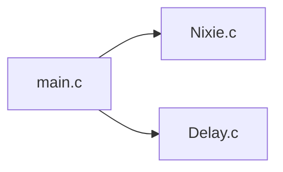

# 第 4 讲：数码管

> **配套例程**：[51_Project/4Nixie](../51_Project/4Nixie/)
>
> **面向读者**：自动化与信息工程学院学生科学与技术协会大一成员
>
> **硬件平台**：普中 A2 开发板（主控 STC89C52RC，11.0592 MHz 晶振）
>
> **前置要求**：已完成[第 3 讲：按键控制 LED](03_按键控制LED.md)，理解端口输出、软件延时与 `sbit` 位定义。

前三讲我们控制的都是"亮"和"灭"两种状态的 LED。这一讲换一个信息量更大的显示器件——**8 位数码管**。它既能显示 0~9，也能显示 A~F，还能把 8 位数字同时显示出来。

这一讲要解决两个问题：

1. **段码**：怎样用 8 个引脚的高低电平"画"出一个字符？
2. **位选与动态扫描**：只有一组段选线，怎样让 8 位数码管同时显示不同的内容？

同时，这一讲还会兑现第 3 讲结尾留下的一个任务：把 `Delay_ms` 从 `main.c` 里抽出来，做成公共模块。这是本课程**第一次搭建多文件工程**，也是第 5 讲模块化编程的起点。

**本讲功能**：

| 阶段 | 现象 |
| --- | --- |
| 上电后的前 5 秒 | 最右边一位数码管静态显示 `F` |
| 5 秒之后 | 8 位数码管动态扫描，分别显示 `1` ~ `8` |

## 目录

- [写在前面](#写在前面)
- [关于普中 A2](#关于普中-a2)
- [数码管基础](#数码管基础)
  - [七段数码管的结构](#七段数码管的结构)
  - [共阴与共阳](#共阴与共阳)
  - [段码：把字形翻译成字节](#段码把字形翻译成字节)
  - [静态显示与动态显示](#静态显示与动态显示)
- [位选：74HC138](#位选74hc138)
  - [为什么需要译码器](#为什么需要译码器)
  - [真值表与位置对应关系](#真值表与位置对应关系)
  - [代码中的位选](#代码中的位选)
- [动态扫描与消隐](#动态扫描与消隐)
  - [视觉暂留](#视觉暂留)
  - [一次扫描的四个动作](#一次扫描的四个动作)
  - [为什么必须消隐](#为什么必须消隐)
  - [亮度与闪烁的取舍](#亮度与闪烁的取舍)
- [工程结构：第一次多文件](#工程结构第一次多文件)
  - [文件组成](#文件组成)
  - [`.h` 与 `.c` 的分工](#h-与-c-的分工)
  - [在 Keil 中添加源文件](#在-keil-中添加源文件)
- [Delay 模块](#delay-模块)
- [Nixie 模块](#nixie-模块)
- [main.c](#mainc)
- [实验现象](#实验现象)
- [常见问题](#常见问题)
- [从第 3 讲到第 4 讲](#从第-3-讲到第-4-讲)
- [小结](#小结)

---

## 写在前面

建议你对着 Keil 打开配套工程，一边看代码一边读——**光看不敲是学不会单片机的**。

每个知识点后面如果标了 **⚠**，说明这是初学者最容易踩的坑。

> 📁 本讲完整代码已收录在本仓库：[51_Project/4Nixie](../51_Project/4Nixie/)
>
> 工程由 `main.c`、`Nixie.c/h`、`Delay.c/h` 共 5 个源文件组成，可直接用 Keil 打开 `.uvproj` 编译烧录。

做本实验前，先确认两件事：

- 数码管位选附近的跳线（普中 A2 上常见丝印为 **J13**）要接到 **74HC138 的 Y0~Y7 一侧**。如果跳错，位选信号根本到不了数码管，现象是"段码怎么写都不亮"。
- 数码管的位选用了 **P2.2、P2.3、P2.4**，而 LED 模块也挂在 P2 口上。两者同时使用会互相干扰，实验时按丝印断开不需要的模块跳线即可。

---

## 关于普中 A2

本讲用到的硬件：

| 模块 | 连接方式 | 本讲是否用到 |
| --- | --- | --- |
| 8 位数码管 | 共阴极；段选接 **P0**（经 74HC245 缓冲），位选由 74HC138 完成 | ✅ |
| 74HC245 | 段选缓冲/驱动，把 P0 的信号送到数码管 | ✅ |
| 74HC138 | 3-8 译码器，A/B/C 分别接 **P2.2 / P2.3 / P2.4**，输出低电平选中一位 | ✅ |
| 8 个 LED | 接 P2.0 ~ P2.7，共阳极，低电平点亮 | ⚠ 与位选共用 P2.2~P2.4 |
| 4 个独立按键 | K1→P3.1、K2→P3.0、K3→P3.2、K4→P3.3 | 第 3 讲已使用 |
| 晶振 | 11.0592 MHz | ✅ |

> ⚠ **数码管是共阴极的。** 段选引脚输出 **高电平** 时对应的段点亮，输出低电平时熄灭。如果你手里是共阳极数码管，整张段码表都要按位取反，这一点后文会再说明。

---

## 数码管基础

### 七段数码管的结构

一位数码管内部其实是 8 个 LED：7 个长条形的段，加上 1 个右下角的小数点。

```text
         a
       ┌───┐
     f │   │ b
       ├─g─┤
     e │   │ c
       └───┘   · dp
         d
```

- 7 个段分别命名为 **a、b、c、d、e、f、g**；
- 小数点命名为 **dp**（decimal point）；
- 8 位数码管就是把 8 个这样的"一位"封装在一起，共用一组段选线，但每一位的公共端单独引出。普中 A2 上用的是两块 4 位共阴数码管，拼成 8 位。

所以数码管的控制分成两路：

| 信号 | 作用 | 本工程接法 |
| --- | --- | --- |
| **段选** | 决定"显示什么字形" | P0 的 8 个引脚，对应 `dp g f e d c b a` |
| **位选** | 决定"哪一位亮" | 74HC138 的 Y0~Y7，任一时刻只选中一位 |

### 共阴与共阳

8 个段本质上是 8 个 LED，它们必须有一个公共端：

| 类型 | 公共端接法 | 段选电平 | 本工程 |
| --- | --- | --- | --- |
| **共阴极** | 8 个 LED 的阴极连在一起，公共端接地 | 段选输出 **高电平** 点亮 | ✅ 普中 A2 |
| **共阳极** | 8 个 LED 的阳极连在一起，公共端接 VCC | 段选输出 **低电平** 点亮 | 否 |

本讲全部按**共阴极**讲解。记住一句话：

> **共阴：写 1 亮，写 0 灭。**

### 段码：把字形翻译成字节

P0 的 8 个引脚正好对应 8 个段。约定从高位到低位依次是：

```text
bit:   7   6   5   4   3   2   1   0
段:   dp   g   f   e   d   c   b   a
```

想让数码管显示 `0`，需要点亮 a、b、c、d、e、f 六段，g 和 dp 熄灭：

```text
dp g f e d c b a
 0 0 1 1 1 1 1 1   = 0b00111111 = 0x3F
```

这就是 **段码**（也叫字形码）。把 0~F 全部算出来，就得到工程里的这张表：

| 字符 | dp g f e d c b a | 十六进制 |
| --- | --- | --- |
| `0` | 0011 1111 | `0x3F` |
| `1` | 0000 0110 | `0x06` |
| `2` | 0101 1011 | `0x5B` |
| `3` | 0100 1111 | `0x4F` |
| `4` | 0110 0110 | `0x66` |
| `5` | 0110 1101 | `0x6D` |
| `6` | 0111 1101 | `0x7D` |
| `7` | 0000 0111 | `0x07` |
| `8` | 0111 1111 | `0x7F` |
| `9` | 0110 1111 | `0x6F` |
| `A` | 0111 0111 | `0x77` |
| `b` | 0111 1100 | `0x7C` |
| `C` | 0011 1001 | `0x39` |
| `d` | 0101 1110 | `0x5E` |
| `E` | 0111 1001 | `0x79` |
| `F` | 0111 0001 | `0x71` |

> 💡 **为什么 b 和 d 用小写？** 七段数码管拼不出标准的大写 `B` 和 `D`，只能用小写形状 `b`、`d` 代替，所以段码表里习惯写成 `b`、`d`。

> ⚠ **段码不是"数字编码"，而是"位映射"。** `0x3F` 之所以表示 0，是因为它的低 6 位刚好对应 a~f 六段，而不是因为 0x3F 和数字 0 有什么数学关系。段码表必须对着电路和字形自己核对，不能死记。

小数点 `dp` 对应最高位 `bit 7`。想让某个字符带小数点，只要把段码和 `0x80` 按位或：

```c
smgd_code[0] | 0x80    // 显示 "0."
```

### 静态显示与动态显示

| 方式 | 做法 | 优点 | 缺点 |
| --- | --- | --- | --- |
| **静态显示** | 选中一位后，段码保持不变，不切换 | 控制简单、亮度高 | 8 位需要 8 组段选线，引脚不够 |
| **动态显示** | 8 位共用一组段选线，快速轮流选中每一位 | 省引脚，只需 8 + 3 根线 | 需要扫描和消隐，程序复杂一些 |

本工程的 `main.c` 把两种方式都演示了一遍：

1. 上电后先**静态**显示一个 `F`，保持 5 秒；
2. 然后进入 `while(1)`，用**动态扫描**在 8 位上显示 `1`~`8`。

---

## 位选：74HC138

### 为什么需要译码器

8 位数码管需要 8 根位选线。如果用 8 个 GPIO 直接控制，光位选就占掉 8 个引脚；再加上段选 8 个，一个数码管模块就要 16 个引脚，51 单片机根本不够用。

**74HC138** 是一个 3-8 译码器：用 3 根输入线（A、B、C），译出 8 根输出线（Y0~Y7），任意时刻只有一根输出有效。这样位选只需要 3 个引脚。

```text
             ┌──────────┐
  P2.2 ──A───┤          │
  P2.3 ──B───┤  74HC138 ├──Y0~Y7──→ 8 位数码管的公共阴极
  P2.4 ──C───┤          │
             └──────────┘
```

74HC138 的输出是 **低电平有效**：

- 被选中的那一路输出 **0**；
- 其余 7 路输出 **1**。

对共阴极数码管来说，公共阴极被拉低，这一位才有电流通路，才能点亮。

### 真值表与位置对应关系

本工程中，C 接 P2.4（最高位），B 接 P2.3，A 接 P2.2（最低位）。真值表如下：

| C（P2.4） | B（P2.3） | A（P2.2） | 被拉低的输出 | 代码中的 position |
| --- | --- | --- | --- | --- |
| 0 | 0 | 0 | Y0 | 8 |
| 0 | 0 | 1 | Y1 | 7 |
| 0 | 1 | 0 | Y2 | 6 |
| 0 | 1 | 1 | Y3 | 5 |
| 1 | 0 | 0 | Y4 | 4 |
| 1 | 0 | 1 | Y5 | 3 |
| 1 | 1 | 0 | Y6 | 2 |
| 1 | 1 | 1 | Y7 | 1 |

注意 `position` 这一列：`Nixie.c` 的注释写的是"**从右向左依次是 1~8**"，所以：

- `position = 1` 对应 `CBA = 111`，即 **Y7**，是最右边一位；
- `position = 8` 对应 `CBA = 000`，即 **Y0**，是最左边一位。

> ⚠ **position 的编号是代码约定，不是数码管的通用规则。** 不同开发板、不同排线方向可能正好左右相反。判断方法很简单：让程序在 `position = 1` 的位置显示一个 `1`，看它实际亮在哪一边。如果方向相反，把调用改成 `SMG_Display(9 - i, ...)` 就能调换。

### 代码中的位选

`Nixie.c` 用一条 `switch` 语句把 `position` 翻译成 138 的三根输入线：

```c
switch(position)
{
    case 1: SMG_C=1; SMG_B=1; SMG_A=1; break;
    case 2: SMG_C=1; SMG_B=1; SMG_A=0; break;
    case 3: SMG_C=1; SMG_B=0; SMG_A=1; break;
    case 4: SMG_C=1; SMG_B=0; SMG_A=0; break;
    case 5: SMG_C=0; SMG_B=1; SMG_A=1; break;
    case 6: SMG_C=0; SMG_B=1; SMG_A=0; break;
    case 7: SMG_C=0; SMG_B=0; SMG_A=1; break;
    case 8: SMG_C=0; SMG_B=0; SMG_A=0; break;
}
SMG_DX = smgd_code;    // 发送段选数据
```

先确定"哪一位"，再写"显示什么"，顺序不能反——后文讲消隐时会解释原因。

---

## 动态扫描与消隐

### 视觉暂留

动态显示的核心是**视觉暂留**：人眼对亮度的感知有短暂停留，如果每一位点亮的时间足够短、切换足够快，看上去就像 8 位同时亮着。

一般要求整屏刷新率高于 **50 Hz**，也就是 8 位轮流显示一遍的时间不超过 20 ms。本工程每位停留约 1 ms，8 位一轮大约 8~10 ms，刷新率约 **100 Hz**，肉眼看不到闪烁。

### 一次扫描的四个动作

`main.c` 的动态显示循环，每一轮对第 `i` 位做四件事：

```text
① 位选：用 138 选中第 i 位
        ↓
② 段选：把第 i 位要显示的字形码写到 P0
        ↓
③ 延时：保持约 1 ms，让这一位亮够时间
        ↓
④ 消隐：把段码清零，让这一位先熄灭
```

用代码表示就是：

```c
SMG_Display(i, smgd_code[i]);   // ① 位选 + ② 段选
Delay_ms(1);                    // ③ 保持 1ms
SMG_Display(i, 0x00);           // ④ 消隐
```

### 为什么必须消隐

如果省略第 ④ 步，会发生**重影**（也叫"拖影"）：

```text
时间轴 →
位选:   第1位        第2位
段选:   "1"  ──────── "2" ...
              ↑
        这里位选已经切到第2位，
        但 P0 上还保留着第1位的段码 "1"
```

在"位选已经切换、段码还没更新"的极短时间内，第 2 位会错误地显示第 1 位的字形，看起来就是每位都带着上一位的影子。

消隐的做法是在切换位之前，先把段码全部清零（共阴极写 `0x00` 即全灭）：

```text
位选 1 → 段选 "1" → 延时 → 段选 0（熄灭）→ 位选 2 → 段选 "2" → ...
```

这样切换位选的瞬间，P0 是全 0 的，不会把上一位的字形带到下一位。

> 💡 **消隐放在延时之后、下一次位选之前**，是本工程采用的顺序。把它放在每次位选之后、段选之前，效果相同；关键是**切换位选时，段码必须是熄灭状态**。

### 亮度与闪烁的取舍

动态扫描时，每一位只在自己被选中的那 1 ms 内发光，一轮 8~10 ms，占空比大约 **10%**，所以动态显示的亮度会明显低于静态显示。

| 每位停留时间 | 亮度 | 闪烁 |
| --- | --- | --- |
| 太短（如 0.1 ms） | 很暗 | 不容易看出 |
| 约 1 ms（本工程） | 适中 | 看不到 |
| 太长（如 5 ms） | 更亮 | 整屏刷新率降到约 25 Hz，开始闪 |

> ⚠ **不要为了让数码管更亮而无限加大 `Delay_ms(1)` 的参数。** 8 位一轮的总时间会跟着变长，刷新率低于 50 Hz 后就会看到明显闪烁。想提高亮度，应该从硬件（限流电阻、驱动能力）或降低扫描位数上想办法。

---

## 工程结构：第一次多文件

### 文件组成

打开 [51_Project/4Nixie](../51_Project/4Nixie/)，你会看到这样的结构：

```text
4Nixie/
├── main.c          # 主函数：显示流程、段码表
├── Nixie.c         # 数码管驱动：位选、段选
├── Nixie.h         # 数码管模块对外提供的函数声明
├── Delay.c         # 延时函数
├── Delay.h         # 延时模块对外提供的函数声明
├── STARTUP.A51     # 启动代码（Keil 自动加入）
└── Nixie_tube.uvproj  # Keil 工程文件
```

模块之间的调用关系：



`main.c` 只负责"显示什么、显示多久"；`Nixie.c` 负责"怎么选中一位、怎么送上段码"；`Delay.c` 负责"等多久"。三者各司其职，这就是**模块化**。

### `.h` 与 `.c` 的分工

| 文件 | 放什么 | 给谁看 |
| --- | --- | --- |
| `xxx.h` | 函数**声明** | 给其他 `.c` 文件看（"这个模块能做什么"） |
| `xxx.c` | 函数**定义**（具体实现） | 给编译器看（"具体怎么做"） |

`main.c` 想调用数码管函数，只需要：

```c
#include "Nixie.h"
```

就能看到 `SMG_Display` 的"说明书"。真正的函数体在 `Nixie.c` 里，由链接器最后拼在一起。

头文件还要加**头文件保护**，防止被重复包含：

```c
#ifndef __NIXIE_H
#define __NIXIE_H

/* ……内容…… */

#endif
```

第 5 讲会对模块化编程做更完整的展开，本讲先把结构跑通。

### 在 Keil 中添加源文件

把 `.c` 文件复制到工程目录后，**还必须手动加入工程**，否则 Keil 不会编译它：

1. 在左侧 **Project** 窗口展开 **Target 1 → Source Group 1**；
2. 右键 **Source Group 1 → Add Existing Files to Group 'Source Group 1'...**；
3. 选中 `Nixie.c`、`Delay.c`，点击 **Add**，再点 **Close**；
4. 重新 **Build**（F7）。

`.h` 文件不需要加入工程，它们是被 `#include` 自动找到的。

> ⚠ **只把 `.c` 文件放进文件夹、忘了加入工程**，编译能过，但链接时会报：
>
> ```text
> *** ERROR L127: UNRESOLVED EXTERNAL SYMBOL
>     SYMBOL: SMG_Display
> ```
>
> 意思是"`main.c` 调用了 `SMG_Display`，但链接器找不到它的实现"。看到这类错误，先检查对应的 `.c` 有没有加入工程。

---

## Delay 模块

第 3 讲结尾的[经验一](03_按键控制LED.md#经验一delay_ms-应该抽成公共模块)提出：`Delay_ms` 每个工程都要用，应该抽成公共模块。本讲就把它真正落地。

`Delay.h`：

```c
#ifndef __DELAY_H
#define __DELAY_H

/* 函数声明 */
void Delay_ms(unsigned int ms);

#endif
```

`Delay.c`：

```c
/* 调用头文件 */
#include "reg52.h"
#include "Delay.h"
#include <intrins.h>	// 提供_nop_()函数

/**
  * @brief	延时函数：产生一段时间的延时效果
  * @param	ms 想要产生延时的毫秒数
  * @retval	无
*/
void Delay_ms(unsigned int ms)
{
	unsigned int i,j;
	for(i = ms;i > 0;i--)
	{
		// 11.0592MHz晶振，921个机器周期约为1ms
		for(j = 110;j > 0;j--)	
		{
			_nop_();		// 空操作，消耗1个机器周期
		}
	}
}
```

这段代码和第 2、3 讲完全一样，只是搬到了独立文件里。内层循环 110 次是 11.0592 MHz 晶振下的经验值，实际延时略大于 1 ms；对本讲"每位亮 1 ms"的要求来说，这点误差完全可以接受。

> 💡 **第 5 讲会给这个模块再加一个 `Delay_10us`。** 到那时你会看到：模块化之后，新增函数只需要改 `Delay.c` 和 `Delay.h`，其他文件一行都不用动。

---

## Nixie 模块

`Nixie.h`：

```c
#ifndef __NIXIE_H
#define __NIXIE_H

/* 函数声明 */
void SMG_Display(unsigned char position,unsigned char smgd_code);

#endif
```

`Nixie.c`：

```c
/* 调用头文件 */
#include "reg52.h"
#include "Nixie.h"

/* 引脚定义 */
#define SMG_DX P0		// 段选
sbit SMG_A = P2^2;		// 38译码器控制引脚
sbit SMG_B = P2^3;
sbit SMG_C = P2^4;


/**
  * @brief	在数码管指定位置显示一个字符
  * @param	position  指定位置（位）从右向左依次是1~8
			smgd_code 显示的字符
  * @retval	无
*/
void SMG_Display(unsigned char position,unsigned char smgd_code)
{
	switch(position)	// 判断以及发送位选数据
	{
		case 1: SMG_C=1;SMG_B=1;SMG_A=1;break;
		case 2: SMG_C=1;SMG_B=1;SMG_A=0;break;
		case 3: SMG_C=1;SMG_B=0;SMG_A=1;break;
		case 4: SMG_C=1;SMG_B=0;SMG_A=0;break;
		case 5: SMG_C=0;SMG_B=1;SMG_A=1;break;
		case 6: SMG_C=0;SMG_B=1;SMG_A=0;break;
		case 7: SMG_C=0;SMG_B=0;SMG_A=1;break;
		case 8: SMG_C=0;SMG_B=0;SMG_A=0;break;
	}
	SMG_DX = smgd_code;	// 发送段选数据
}
```

### 引脚定义

```c
#define SMG_DX P0
sbit SMG_A = P2^2;
sbit SMG_B = P2^3;
sbit SMG_C = P2^4;
```

这里同时用到了第 3 讲[经验二](03_按键控制LED.md#经验二位操作用-sbit整端口操作用-define)的两种写法：

- **段选**要一次写 8 位，所以用 `#define SMG_DX P0`，把它当成一个整体；
- **位选**只操作 P2 的某一位，所以用 `sbit` 定义成单独的位变量。

### `SMG_Display` 的两步

函数只做两件事：

1. **位选**：根据 `position` 设置 C/B/A，让 138 选中对应的一位；
2. **段选**：把 `smgd_code` 写到 P0，决定这一位显示什么。

参数 `smgd_code` 是"要显示的字形码"，不是数字本身。想显示数字 `1`，要传入 `0x06`，而不是 `1`。段码表放在 `main.c` 里，`Nixie.c` 只负责"把给定的码送出去"，不关心它代表哪个字符——这样显示内容和驱动逻辑就解耦了。

> ⚠ **`switch` 没有 `default` 分支。** 本工程的调用都保证 `position` 在 1~8 之间，所以不会出问题；如果传入 0 或 9，位选会保持上一次的状态，只有段码被更新。自己扩展功能时，最好补一个 `default`，或者在使用前检查参数范围。

> ⚠ **`sbit` 定义放在 `.c` 文件里，不要放进 `.h`。** 位变量是"定义"，如果头文件被多个 `.c` 包含，就会出现重复定义。头文件里只放函数声明。

---

## main.c

完整代码：

```c
/* 调用头文件 */
#include "reg52.h"
#include "Nixie.h"
#include "Delay.h"

/* 变量定义 */
unsigned char smgd_code[16]={0x3f,0x06,0x5b,0x4f,0x66,0x6d,0x7d,0x07,
							0x7f,0x6f,0x77,0x7c,0x39,0x5e,0x79,0x71};	// 共阴极数码管0~F段码表


/**
  * @brief	主函数
  * @param	无
  * @retval	无
*/
int main(void)
{
	unsigned char i = 1;
	
	SMG_Display(i,smgd_code[15]);	// 	静态数码管显示F
	Delay_ms(5000);
	
	while(1)
	{
		for(i = 1;i <= 8;i++)				// 动态数码管
		{
			SMG_Display(i,smgd_code[i]);	// 按位发送显示数据
			Delay_ms(1);					// 等待显示稳定
			SMG_Display(i,0x00);			// 清空段选
		}
	}
}
```

### 头文件与段码表

```c
#include "reg52.h"
#include "Nixie.h"
#include "Delay.h"
```

`main.c` 用到了数码管显示和延时，所以包含这两个模块的头文件。它**没有**直接操作 P0/P2，也不需要知道 138 的真值表——那些细节都封装在 `Nixie.c` 里。

段码表有 16 个元素，下标 0~15 分别对应字符 `0`~`F`：

```c
unsigned char smgd_code[16]={0x3f,0x06,0x5b,0x4f,0x66,0x6d,0x7d,0x07,
							0x7f,0x6f,0x77,0x7c,0x39,0x5e,0x79,0x71};
```

- `smgd_code[0]` = `0x3F`，显示 `0`；
- `smgd_code[1]` = `0x06`，显示 `1`；
- ……
- `smgd_code[15]` = `0x71`，显示 `F`。

### 前 5 秒：静态显示 `F`

```c
unsigned char i = 1;

SMG_Display(i,smgd_code[15]);	// 静态数码管显示F
Delay_ms(5000);
```

这里只调用了一次 `SMG_Display`：

1. `position = 1`，138 选中第 1 位（按代码约定是最右边一位）；
2. 段码 `smgd_code[15] = 0x71`，显示 `F`；
3. 之后 5 秒内不再改变位选和段码，这一位就**一直亮着**。

这就是"静态显示"：不需要扫描，亮度最高，但同一时刻只能显示一位。

> ⚠ 这 5 秒里 CPU 一直卡在 `Delay_ms(5000)` 里，什么也做不了。这是软件延时的通病，第 3 讲已经提过；后面学定时器中断才能真正解决。

### 后 5 秒：动态扫描 `1`~`8`

```c
while(1)
{
	for(i = 1;i <= 8;i++)
	{
		SMG_Display(i,smgd_code[i]);	// 按位发送显示数据
		Delay_ms(1);					// 等待显示稳定
		SMG_Display(i,0x00);			// 清空段选
	}
}
```

逐句看：

1. `for(i = 1; i <= 8; i++)`：依次处理第 1~8 位；
2. `SMG_Display(i, smgd_code[i])`：第 `i` 位显示数字 `i`；
3. `Delay_ms(1)`：让这一位亮约 1 ms；
4. `SMG_Display(i, 0x00)`：把这一位的段码清零，完成**消隐**；
5. 循环回到第 1 位，开始下一轮扫描。

### 时间账

一轮扫描的时间大约是：

```text
8 位 × (1 ms 延时 + 函数调用/循环开销) ≈ 8 ~ 10 ms
```

对应刷新率：

```text
1 / 0.008 s ≈ 125 Hz
1 / 0.010 s ≈ 100 Hz
```

都远高于人眼能察觉闪烁的 50 Hz，所以看起来 8 位是同时亮着的。

---

## 实验现象

烧录后，你会看到：

1. **上电后的前 5 秒**：最右边一位数码管稳定显示 `F`。因为是静态显示，这一位比后面的动态显示更亮。
2. **5 秒之后**：8 位数码管同时显示 `1`~`8`。按本工程 `position` 的定义（1 为最右位），从左到右看到的是：

   ```text
   8 7 6 5 4 3 2 1
   ```

   如果你的板子实际排线方向相反，看到 `1 2 3 4 5 6 7 8` 也说明程序工作正常，只是左右镜像；想调换顺序，把循环里的 `SMG_Display(i, smgd_code[i])` 改成：

   ```c
   SMG_Display(9 - i, smgd_code[i]);
   ```

3. **走近或晃动开发板**：动态扫描的画面可能会有轻微拖影，这是正常的；但如果看到明显的"重影数字"，说明消隐没生效，检查 `SMG_Display(i, 0x00)` 是否被漏掉。

---

## 常见问题

### 1. 8 位数码管完全不亮

按顺序检查：

1. **位选跳线**：J13（或板上对应丝印）是否接到 74HC138 的 Y0~Y7 一侧；
2. **段选通路**：P0 到 74HC245 再到数码管的连接是否正常；
3. **共阴/共阳**：本工程的段码是给共阴极用的；如果误用共阳极数码管，所有段码都要按位取反；
4. **供电**：开发板是否正常上电，数码管模块是否有电。

### 2. 只有一位亮，或者亮的位置不对

- 检查 `SMG_A/B/C` 是否分别接在 P2.2/P2.3/P2.4；
- 检查 138 的 A/B/C 顺序有没有接反（A 是最低位）；
- 如果位置整体左右镜像，是 `position` 编号方向的问题，用 `9 - i` 调换即可；
- 如果只有某一位永远不亮，检查对应的 Y 输出和数码管公共端。

### 3. 数字有重影 / 拖影

消隐没做或做得不对。确认每一轮都有：

```c
SMG_Display(i, smgd_code[i]);
Delay_ms(1);
SMG_Display(i, 0x00);    // 这一行不能少
```

并确认**切换位选时段码是 0**。

### 4. 数码管闪烁

- 每位停留时间太长，整屏刷新率低于 50 Hz。把 `Delay_ms(1)` 调小；
- 或者扫描位数太多、单轮时间过长；
- 也可能是电源不稳或杜邦线接触不良，先排除硬件。

### 5. 数码管很暗

- 动态扫描的占空比只有约 1/8，比静态显示暗是正常的；
- 检查限流电阻是否过大；
- 确认 74HC245 的使能/方向引脚状态正确；
- 不要单纯靠加大延时提亮，否则会闪烁。

### 6. 显示的字形不对（乱码）

- 段码表的位序必须是 `dp g f e d c b a`，从高位到低位；
- 检查段码是共阴还是共阳；
- 检查 P0 的 8 根线是否按 a~dp 的顺序连接；
- 单独显示 `0x3F`，确认是否显示 `0`，以此定位是段码还是接线问题。

### 7. 编译通过，链接报 `UNRESOLVED EXTERNAL SYMBOL`

对应的 `.c` 没有加入 Keil 工程。把 `Nixie.c`、`Delay.c` 加入 **Source Group 1**，重新编译。

### 8. 一直显示 `F`，不进入动态扫描

- `Delay_ms(5000)` 确实会阻塞 5 秒，耐心等待；
- 检查 `while(1)` 是否写成了 `while(0)`；
- 检查 `for` 循环是否因为 `i` 的类型或边界写错而一次都不执行。

---

## 从第 3 讲到第 4 讲

这一讲和前一讲相比，有三个明显的变化：

| 方面 | 第 3 讲 | 第 4 讲 |
| --- | --- | --- |
| 主要方向 | GPIO **输入**：读按键 | GPIO **输出**：驱动显示 |
| 程序结构 | 单文件 `main.c` | 多文件：`main.c` + `Nixie` + `Delay` |
| 时间控制 | 消抖延时、等待释放 | 动态扫描的 1 ms 节拍 |
| 新硬件 | 按键、准双向口 | 数码管、74HC245、74HC138 |

**经验一的落地**：第 3 讲说"`Delay_ms` 应该抽成公共模块"，这一讲真的把它抽出来了。以后每个工程都可以直接复制 `Delay.c/h`，或者像第 5 讲那样继续往里面加函数。

**模块化的第一步**：本讲只是把"延时"和"数码管"拆了出去，`main.c` 仍然负责显示流程和段码表。第 5 讲会继续拆分按键和蜂鸣器，让你看到一个完整的多模块工程长什么样。

**仍然存在的问题**：无论是 5 秒的静态显示，还是 1 ms 的扫描节拍，都靠 `Delay_ms` 死等。CPU 在延时期间不能做别的事，这就是"阻塞式编程"。等你学了定时器中断，动态扫描可以交给定时器自动完成，主循环就能腾出来处理按键、串口等其他任务。

---

## 小结

| 知识点 | 出现在哪里 |
| --- | --- |
| 七段数码管的结构（a~g + dp） | 七段数码管的结构 |
| 共阴/共阳的区别与段选电平 | 共阴与共阳 |
| 段码表的位序 `dp g f e d c b a` | 段码：把字形翻译成字节 |
| 小数点 `dp` 与按位或 `0x80` | 段码：把字形翻译成字节 |
| 静态显示与动态显示的区别 | 静态显示与动态显示 |
| 74HC138 的 3-8 译码与低电平有效 | 位选：74HC138 |
| `position` 与 CBA/Y 输出的对应关系 | 真值表与位置对应关系 |
| 视觉暂留与 50 Hz 刷新率 | 视觉暂留 |
| 动态扫描的四个动作 | 一次扫描的四个动作 |
| 消隐与重影 | 为什么必须消隐 |
| 占空比、亮度与闪烁的取舍 | 亮度与闪烁的取舍 |
| 多文件工程与 `.h`/`.c` 分工 | 工程结构：第一次多文件 |
| `Delay` 模块的抽取 | Delay 模块 |
| `#define` 整端口与 `sbit` 单引脚 | Nixie 模块 |

**下一讲**：[第 5 讲：蜂鸣器](05_蜂鸣器.md)——在按键控制的基础上，把 `Delay`、`Key`、`Buzzer` 拆成完整模块，进一步学习多文件工程，并用方波频率控制音调。

**练习建议**：

1. 把静态显示的 `F` 改成 `0`、`A` 或你的学号最后一位，观察段码表是否用对；
2. 让动态显示从左到右变成 `1 2 3 4 5 6 7 8`（提示：`SMG_Display(9 - i, ...)`）；
3. 给某一位加上小数点，例如显示 `1.`；
4. 把 `Delay_ms(1)` 改成 `Delay_ms(5)`，观察亮度与闪烁的变化，算一算此时的刷新率；
5. 试着让数码管从 `8` 倒数到 `1`，或者只让奇数位显示；
6. 思考：如果要在动态扫描的同时读取按键，当前的 `Delay_ms` 写法会带来什么问题？

学习过程中遇到问题，欢迎在预备成员群里提问，或者直接私信学长学姐。
