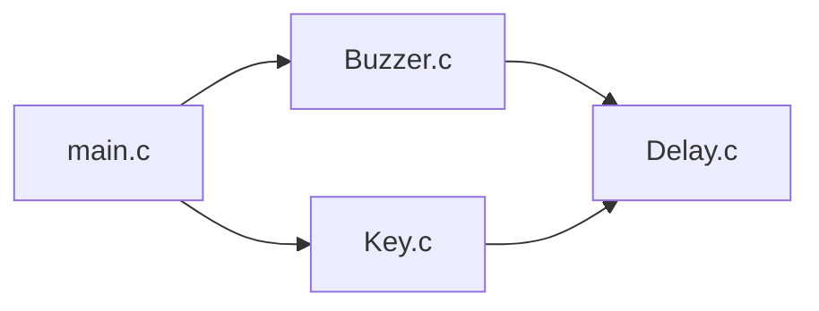
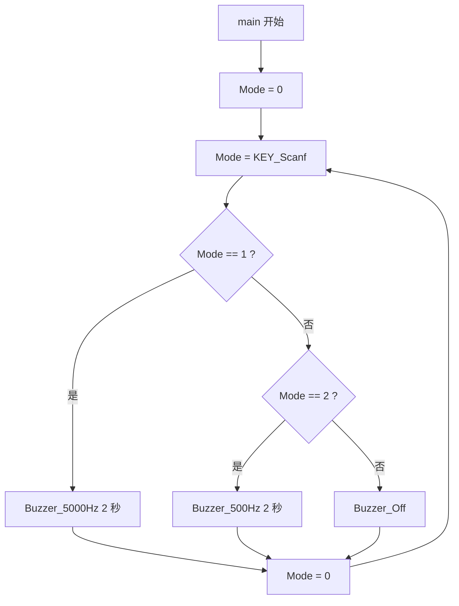

# 第 5 讲：蜂鸣器

> **配套例程**：[51_Project/5Buzzer](../51_Project/5Buzzer/)
>
> **面向读者**：自动化与信息工程学院学生科学与技术协会大一成员
>
> **硬件平台**：普中 A2 开发板（主控 STC89C52RC，11.0592 MHz 晶振）
>
> **前置要求**：已完成[第 4 讲：数码管](04_数码管.md)，理解多文件工程与 `Delay` 模块；第 3 讲的按键扫描、软件消抖与 `sbit` 位定义会在本讲继续使用。

第 1~3 讲的程序都写在 `main.c` 里；第 4 讲已经把 `Delay` 和数码管驱动拆成了独立模块。这一讲在此基础上继续拆分：把按键扫描和蜂鸣器驱动也做成模块，最终形成一个由 `Delay`、`Key`、`Buzzer` 三个模块加 `main.c` 组成的工程。这是从"能跑的小实验"走向"能维护的工程"的又一步。

**功能**：

| 操作 | 现象 |
| --- | --- |
| 按 K1 | 蜂鸣器以 5000 Hz 响约 2 秒（高音） |
| 按 K2 | 蜂鸣器以 500 Hz 响约 2 秒（低音） |
| 按 K3 / K4 | 关闭蜂鸣器（本工程未给它们分配功能） |
| 不按键 | 关闭蜂鸣器 |

## 目录

- [写在前面](#写在前面)
- [关于普中 A2](#关于普中-a2)
- [从单文件到多文件](#从单文件到多文件)
  - [工程文件组成](#工程文件组成)
  - [为什么要拆分](#为什么要拆分)
  - [`.h` 与 `.c` 的分工](#h-与-c-的分工)
  - [头文件保护](#头文件保护)
  - [在 Keil 中添加源文件](#在-keil-中添加源文件)
- [蜂鸣器基础](#蜂鸣器基础)
  - [有源蜂鸣器与无源蜂鸣器](#有源蜂鸣器与无源蜂鸣器)
  - [频率决定音调](#频率决定音调)
  - [驱动电路](#驱动电路)
- [Delay 模块](#delay-模块)
- [Key 模块](#key-模块)
- [Buzzer 模块](#buzzer-模块)
- [main.c](#mainc)
- [编译与实验现象](#编译与实验现象)
- [常见问题](#常见问题)
- [小结](#小结)

---

## 写在前面

建议你对着 Keil 打开配套工程，一边看代码一边读——**光看不敲是学不会单片机的**。

每个知识点后面如果标了 **⚠**，说明这是初学者最容易踩的坑。

> 📁 本讲完整代码已收录在本仓库：[51_Project/5Buzzer](../51_Project/5Buzzer/)
>
> 工程由 `main.c`、`Buzzer.c/h`、`Key.c/h`、`Delay.c/h` 共 7 个源文件组成，可直接用 Keil 打开 `.uvproj` 编译烧录。

---

## 关于普中 A2

| 模块 | 连接方式 | 本讲是否用到 |
| --- | --- | --- |
| 蜂鸣器 | 工程定义在 **P2.5** | ✅ |
| 4 个独立按键 | K1→P3.1、K2→P3.0、K3→P3.2、K4→P3.3，另一端接 GND | ✅ |
| LED | P2.0 ~ P2.7，共阳极，低电平点亮 | 本讲不用 |
| 晶振 | 11.0592 MHz | ✅ |

> ⚠ **蜂鸣器跳线**
>
> 普中 A2 的蜂鸣器模块是通过跳线接到 P2.5 的，做实验前先确认对应跳线已按板子丝印连接好。
>
> 同时，P2 口上还挂着 LED 模块。如果蜂鸣器实验中出现"按一下响一下、LED 也跟着闪"的干扰，按丝印断开不需要的模块跳线即可。

---

## 从单文件到多文件

### 工程文件组成

打开 [51_Project/5Buzzer](../51_Project/5Buzzer/)，你会看到这样的结构：

```text
5Buzzer/
├── main.c        # 主函数：把各个模块串起来
├── Buzzer.c      # 蜂鸣器驱动：发声、关闭
├── Buzzer.h      # 蜂鸣器模块对外提供的函数声明
├── Key.c         # 按键扫描
├── Key.h         # 按键模块对外提供的函数声明
├── Delay.c       # 延时函数
├── Delay.h       # 延时模块对外提供的函数声明
├── STARTUP.A51   # 启动代码（Keil 自动加入）
└── Buzzer.uvproj # Keil 工程文件
```

模块之间的调用关系：



`main.c` 只关心"按键返回什么、对应调用哪个蜂鸣器函数"，不需要知道延时是怎么实现的；`Buzzer.c` 和 `Key.c` 各自依赖 `Delay.c`，也不需要知道对方的存在。这就是**模块化**。

### 为什么要拆分

| 单文件写法 | 多文件写法 |
| --- | --- |
| 所有代码挤在一个 `main.c` | 每个功能一个模块 |
| 找代码靠搜索、翻页 | 按文件名就能定位 |
| 复制粘贴复用 | `#include` 即可复用 |
| 改一处容易影响别处 | 修改被隔离在模块内部 |
| 多人协作时容易冲突 | 不同人负责不同文件 |

第 3 讲的[经验一](03_按键控制LED.md#经验一delay_ms-应该抽成公共模块)提出要把 `Delay_ms` 抽成公共模块，第 4 讲已经落地；本讲在此基础上把 `Key` 和 `Buzzer` 也拆成独立模块。

### `.h` 与 `.c` 的分工

这是初学者最困惑的地方：**为什么一个模块要两个文件？**

| 文件 | 放什么 | 给谁看 |
| --- | --- | --- |
| `xxx.h` | 函数**声明**、宏定义、类型定义 | 给**其他文件**看（"这个模块能做什么"） |
| `xxx.c` | 函数**定义**（具体实现） | 给**编译器**看（"具体怎么做"） |

以蜂鸣器模块为例：

`Buzzer.h`：

```c
#ifndef __BUZZER_H
#define __BUZZER_H

/* 函数声明 */
void Buzzer_5000Hz(unsigned char time);
void Buzzer_500Hz(unsigned char time);
void Buzzer_Off(void);

#endif
```

`Buzzer.c`：

```c
/* 调用头文件 */
#include "reg52.h"
#include "Delay.h"

/* 引脚定义 */
sbit Buzzer = P2^5;

/* ……函数的完整实现（见后文）…… */
```

别的文件想用蜂鸣器，只需要：

```c
#include "Buzzer.h"
```

就能看到三个函数的"说明书"，编译器据此检查调用参数是否正确。真正的函数体在 `Buzzer.c` 里，由链接器最后拼在一起。

> ⚠ **最关键的一条规则：`.h` 里只放声明，不放函数定义。**
>
> 如果在头文件里写完整的函数体，而这个头文件又被多个 `.c` 包含，每个 `.c` 都会生成一份同名函数，链接时会报 **multiple definition**（重复定义）。

> ⚠ **第二条规则：一个 `.h` 被哪些文件包含，就决定了谁知道它。**
>
> 本工程里 `main.c` 只 `#include "Buzzer.h"` 和 `"Key.h"`，**没有**包含 `Delay.h`——因为 `main.c` 自己没有直接调用 `Delay_ms` / `Delay_10us`。`Delay.h` 被 `Buzzer.c` 和 `Key.c` 包含，因为它们在实现里要用延时。
>
> 只包含真正需要的头文件，依赖关系才清晰。

### 头文件保护

每个 `.h` 都有这样的结构：

```c
#ifndef __BUZZER_H
#define __BUZZER_H

/* ……内容…… */

#endif
```

这叫**头文件保护（Include Guard）**，作用是：

1. 第一次包含时，`__BUZZER_H` 还没定义，`#ifndef` 成立，内容被展开，同时 `#define __BUZZER_H` 把它标记为"已包含"；
2. 第二次包含时，`__BUZZER_H` 已经有定义，`#ifndef` 不成立，整段内容被跳过。

为什么需要？因为一个头文件可能被**间接包含多次**。例如 `main.c` 包含了 `Buzzer.h`，而 `Buzzer.h` 以后可能又包含别的头文件，很容易出现同一个声明被重复展开。虽然重复**声明**通常不报错，但重复**定义**一定报错，加上保护最省心。

> 💡 **命名建议**：工程里用的是 `__BUZZER_H`。严格按 C 标准，双下划线开头的标识符是编译器保留的，普通代码最好别用。更常见的写法是 `BUZZER_H` 或 `BUZZER_H_`。在 Keil 下 `__BUZZER_H` 不会出问题，但知道这个规范没坏处。

### 在 Keil 中添加源文件

把 `.c` 文件复制到工程目录后，**还必须手动加入工程**，否则 Keil 根本不会编译它：

1. 在左侧 **Project** 窗口展开 **Target 1 → Source Group 1**；
2. 右键 **Source Group 1 → Add Existing Files to Group 'Source Group 1'...**；
3. 选中 `Buzzer.c`、`Key.c`、`Delay.c`（按住 Ctrl 多选），点击 **Add**，再点 **Close**；
4. 重新 **Build**（F7）。

`.h` 文件不需要加入工程，它们是被 `#include` 自动找到的。

> ⚠ **最常见的多文件错误**：只把 `.c` 文件放进文件夹、忘了加入工程。现象是编译能过，但链接时报：
>
> ```text
> *** ERROR L127: UNRESOLVED EXTERNAL SYMBOL
>     SYMBOL: Buzzer_5000Hz
> ```
>
> 意思是"`main.c` 调用了 `Buzzer_5000Hz`，但链接器在所有参与编译的文件里找不到它的实现"。看到这类错误，先检查对应 `.c` 有没有加入工程。

---

## 蜂鸣器基础

### 有源蜂鸣器与无源蜂鸣器

| | 有源蜂鸣器（Active） | 无源蜂鸣器（Passive） |
| --- | --- | --- |
| 内部振荡电路 | 有 | 无 |
| 通电后 | 直接发声 | 不发声（只通电只会"咔"一下） |
| 发声方式 | 给直流电平即可 | 必须输入**方波**信号 |
| 音调 | 固定 | 由输入方波频率决定 |

**本工程用的是无源蜂鸣器。** 代码里没有任何"打开蜂鸣器"的动作，而是：

```c
Buzzer = ~Buzzer;   // 不停地翻转引脚
Delay_10us(10);     // 每 100us 翻转一次
```

翻转产生方波，方波的频率决定音调。如果换成有源蜂鸣器，这段代码也能响，但音调由蜂鸣器自己决定，改频率没有效果。

> ⚠ **判断方法**：给蜂鸣器两端直接接 5 V。响的是有源，不响（或只"咔"一声）的是无源。
>
> 普中 A2 板载蜂鸣器一般是无源的，所以必须用方波驱动。

### 频率决定音调

频率 `f` 和周期 `T` 的关系：

```text
T = 1 / f
```

本工程要产生 50% 占空比的方波，所以**每半个周期翻转一次引脚**：

```text
             ┌────────┐        ┌────────┐
             │        │        │        │
   ──────────┘        └────────┘        └──────────
             ←──T/2──→←──T/2──→
             ←───────── T ────────→
```

| 目标频率 | 周期 T | 半周期 T/2 | 代码中的延时 |
| --- | --- | --- | --- |
| 5000 Hz | 200 μs | 100 μs | `Delay_10us(10)` |
| 500 Hz | 2 ms | 1 ms | `Delay_ms(1)` |

注意：**延时是半周期，不是整个周期**。初学者常犯的错误是把一个周期算成一次延时，结果发出声音的频率只有目标值的一半。

5000 Hz 和 500 Hz 相差 10 倍，人耳听上去就是明显的高音和低音。

### 驱动电路

蜂鸣器的工作电流通常在几十毫安，直接由单片机引脚驱动有两个问题：

1. 51 的引脚灌电流能力约 10 ~ 20 mA，可能不够；
2. 蜂鸣器是感性负载，断电瞬间会产生反向电动势。

所以开发板上一般通过**三极管**（或 ULN2003 之类的驱动芯片）来驱动：

```text
                  VCC (5V)
                    │
                  ┌─┴─┐
                  │蜂鸣器│
                  └─┬─┘
                    │
                  ┌─┴─┐
                  │ 三极管 │←── 基极电阻 ── P2.5
                  └─┬─┘
                    │
                   GND
```

单片机只需要输出很小的基极电流，就能控制三极管通断，由三极管承担蜂鸣器的大电流。具体是 NPN 还是 PNP、有没有上拉，以板子原理图为准——代码只关心 **P2.5 输出方波**。

> ⚠ **不要用引脚直接驱动电机、继电器、蜂鸣器这类大电流/感性负载。** 轻则声音小、工作不稳定，重则烧坏引脚。

---

## Delay 模块

`Delay.c` 提供两个函数：

```c
/* 调用头文件 */
#include "reg52.h"
#include <intrins.h> 	// 提供_nop_()函数

/**
 * @brief  10微秒级延时函数
 * @param  ten_us: 延时参数，当 ten_us = 1 时，约延时 10us
 * @note   基于11.0592MHz晶振，实际延时略大于10us
 */
void Delay_10us(unsigned int ten_us)
{
    while(ten_us--);
}


/**
 * @brief  毫秒级延时函数
 * @param  xms: 需要延时的毫秒数
 * @note   基于11.0592MHz晶振，内层循环次数 110 为经验值，约等于 1ms
 */
void Delay_ms(unsigned int xms)
{
    unsigned int i, j;
    for(i = xms; i > 0; i--)
        for(j = 110; j > 0; j--);
}
```

### Delay_10us：`while(ten_us--);`

这行代码非常短，但包含两个知识点。

**① 后置自减 `ten_us--`**

`while(ten_us--);` 的判断过程是：

1. 取出 `ten_us` 的**当前值**作为循环条件；
2. 无论条件真假，`ten_us` 都减 1；
3. 条件非 0 → 继续循环，条件为 0 → 退出。

以 `ten_us = 3` 为例：

| 轮次 | 条件使用的值 | 判断 | 执行后 ten_us |
| --- | --- | --- | --- |
| 1 | 3 | 真，继续 | 2 |
| 2 | 2 | 真，继续 | 1 |
| 3 | 1 | 真，继续 | 0 |
| 4 | 0 | 假，退出 | 65535（溢出回绕） |

所以循环体执行了 **3 次**，正好对应参数值。

> ⚠ **`ten_us = 0` 时不会死循环。** 第一次判断用的是旧值 0，条件为假，循环直接退出。之后 `ten_us` 变成 65535，但它是函数的局部参数，函数一返回就消失了，不会影响外面。

**② 每次循环到底多久？**

循环体是空的，时间全部花在"16 位变量自减 + 判零 + 跳转"上。在 Keil C51、11.0592 MHz 下，一次迭代大约 **8 ~ 12 个机器周期**：

```text
1 个机器周期 ≈ 1.0851 μs
8 ~ 12 个机器周期 ≈ 8.7 ~ 13 μs
```

所以：

- `Delay_10us(1)` ≈ 10 μs 量级；
- `Delay_10us(10)` ≈ 100 μs 量级；
- `Delay_10us(30)` ≈ 300 μs 量级。

注释里写"实际延时略大于 10us"是合理的，因为函数调用、参数传递、循环控制都有开销。

> ⚠ **和 `Delay_ms` 一样，这不是"精确"延时。** 它受编译器优化等级影响很大：如果 Keil 把空循环优化掉，延时会直接失效。本工程使用默认设置可以正常工作，但正式项目应该用定时器。

### Delay_ms：空循环的风险

```c
void Delay_ms(unsigned int xms)
{
    unsigned int i, j;
    for(i = xms; i > 0; i--)
        for(j = 110; j > 0; j--);
}
```

它和第 3 讲的 `Delay_ms` 结构相同，但内层循环体是**空的**，没有 `_nop_()`。

- 第 3 讲版本用 `_nop_()` 占住循环体，编译器不会删除；
- 本工程版本是纯空循环，**在较高优化等级下可能被编译器整体优化掉**，导致延时为 0。

Keil C51 默认优化等级（Level 8）通常不会删除这种带副作用的循环（`j--` 本身是副作用），所以本工程能正常工作。但这是一个隐患，正式代码建议：

```c
for(j = 110; j > 0; j--)
{
    _nop_();
}
```

另外，`Delay.c` 包含了 `<intrins.h>` 却没有使用 `_nop_()`。包含未使用的头文件不会报错，但也说明这份 `Delay.c` 是从旧版本改过来的，可以顺手清理。

---

## Key 模块

`Key.c` 的扫描逻辑和第 3 讲完全一样，只是**返回值从"直接翻转 LED"变成了"返回键码"**：

```c
/* 调用头文件 */
#include "reg52.h"
#include "Delay.h"

/* 引脚定义 */
sbit KEY1 = P3^1;
sbit KEY2 = P3^0;
sbit KEY3 = P3^2;
sbit KEY4 = P3^3;


/**
  * @brief	按键扫描及处理
  * @param	无
  * @retval key_num 按下按键的编号
			0		没有按键被按下
			1		KEY1被按下
			2		KEY2被按下
			3		KEY3被按下
			4		KEY4被按下
*/
int KEY_Scanf(void)
{
	unsigned char key_num = 0;
	KEY1 = 1;	// 51单片机读取引脚电平值，最好是先将对应引脚设置为高电平
	KEY2 = 1;
	KEY3 = 1;
	KEY4 = 1;
	if(KEY1 == 0)		/* KEY1 */
	{
		Delay_ms(10);	// 消抖
		if(KEY1 == 0)
		{
			key_num = 1;
		}
		while(KEY1 == 0);// 等待按键释放
	}
	else if(KEY2 == 0)		/* KEY2 */
	{
		Delay_ms(10);	// 消抖
		if(KEY2 == 0)
		{
			key_num = 2;
		}
		while(KEY2 == 0);// 等待按键释放
	}
	else if(KEY3 == 0)		/* KEY3 */
	{
		Delay_ms(10);	// 消抖
		if(KEY3 == 0)
		{
			key_num = 3;
		}
		while(KEY3 == 0);// 等待按键释放
	}
	else if(KEY4 == 0)		/* KEY4 */
	{
		Delay_ms(10);	// 消抖
		if(KEY4 == 0)
		{
			key_num = 4;
		}
		while(KEY4 == 0);// 等待按键释放
	}
	return key_num;
}
```

### 与第 3 讲的区别

| | 第 3 讲 `Key_LED` | 本讲 `5Buzzer` |
| --- | --- | --- |
| 按键处理 | 在 `KEY_Scanf` 里直接翻转 LED | 只返回键码，由 `main` 决定做什么 |
| 无按键时返回值 | 不返回（只负责动作） | `0` |
| 调用方 | `main` 直接调用 | `main` 根据返回值分支 |

**为什么要把"读按键"和"做什么"分开？**

因为同一个按键在不同项目里可能对应完全不同的动作：这个项目里 K1 是"高音"，下个项目里可能是"启动电机"。扫描函数只负责"告诉你哪个键被按了"，具体怎么处理交给 `main`。这样 `Key.c` 可以**原样复制到下一个工程**，不用改一行。

这就是模块化的价值：**让每个模块只做一件事。**

### 为什么 `key_num` 每次都从 0 开始

```c
unsigned char key_num = 0;
```

这是**普通局部变量**，每次调用 `KEY_Scanf` 都会重新创建并初始化为 0。所以：

- 按下 K1 → 返回 1；
- 下一次调用时没按键 → 返回 0。

`main` 里的 `else` 分支正是依赖这个 0 来关闭蜂鸣器。

> ⚠ 下一讲的 `6Motor` 会把这里改成 `static unsigned char key_num = 1;`，行为完全不同——那是电机能"松手后继续转"的关键。先记住这个对比，下一讲会详细讲 `static`。

### 等待释放的影响

```c
while(KEY1 == 0);   // 等待按键释放
```

和第 3 讲一样，程序会阻塞在这里。也就是说：

- **按下 K1 后，必须松手**，`KEY_Scanf` 才返回 1；
- 返回之后才开始响 2 秒；
- 响的这 2 秒里，程序卡在发声函数中，按别的键没有反应。

所以实际操作体验是：**按下并松开 K1 → 高音响 2 秒**。这不是 bug，是当前程序结构的必然结果。

---

## Buzzer 模块

```c
/* 调用头文件 */
#include "reg52.h"
#include "Delay.h"

/* 引脚定义 */
sbit Buzzer = P2^5;

/**
  * @brief	设置蜂鸣器发生频率为5000Hz
  * @param	time	发声时间（秒）
  * @retval	无
*/
void Buzzer_5000Hz(unsigned char time)
{
	unsigned int i,j;
	for(i = 0;i < time;i++)	// 约响time秒（方波周期约为200us  5000Hz）
	{
		for(j = 0;j < 10000;j++)
		{
			Buzzer = ~Buzzer;			// 蜂鸣器引脚状态翻转
			Delay_10us(10);
		}
	}
}


/**
  * @brief	设置蜂鸣器发生频率为500Hz
  * @param	time	发声时间（秒）
  * @retval	无
*/
void Buzzer_500Hz(unsigned char time)
{
	unsigned int i,j;
	for(i = 0;i < time;i++)	// 约响time秒（方波周期约为2ms  500Hz）
	{	
		for(j = 0;j < 1000;j++)
		{
			Buzzer = ~Buzzer;			// 蜂鸣器引脚状态翻转
			Delay_ms(1);
		}
	}
}


/**
  * @brief	关闭蜂鸣器
  * @param	无
  * @retval	无
*/
void Buzzer_Off(void)
{
	Buzzer = 0;
}
```

### 引脚定义

```c
sbit Buzzer = P2^5;
```

普中 A2 的蜂鸣器接在 P2.5。和第 3 讲的 LED 一样，`sbit` 把"P2 的第 5 位"命名为 `Buzzer`，以后改硬件只需要改这一行。

> ⚠ `Buzzer` 是**全局** `sbit`，定义在 `Buzzer.c` 中。其他文件不能直接使用它，只能通过 `Buzzer.h` 里声明的函数来操作——这正是模块封装。

### `Buzzer = ~Buzzer;`

这是产生方波的核心：

```text
初始：Buzzer = 0
  第 1 次：~0 → 1，延时 100us
  第 2 次：~1 → 0，延时 100us
  第 3 次：~0 → 1，延时 100us
  ……
```

电平在 0 和 1 之间不停翻转，配合延时，就在引脚上形成了方波。方波的频率由**两次翻转之间的延时**决定。

> 💡 `~` 是按位取反。`Buzzer` 是位变量，参与运算时先提升为 16 位，取反后只保留最低位赋回。实际效果就是 0 ↔ 1 翻转。第 3 讲已经详细分析过。

### Buzzer_5000Hz 的时间账

```c
for(i = 0; i < time; i++)        // 外层：每个 i 响 1 秒
{
    for(j = 0; j < 10000; j++)   // 内层：10000 个半周期
    {
        Buzzer = ~Buzzer;
        Delay_10us(10);          // 半周期约 100us
    }
}
```

| 项目 | 计算 | 结果 |
| --- | --- | --- |
| 半周期 | `Delay_10us(10)` | 约 100 μs |
| 全周期 | 2 × 100 μs | 约 200 μs |
| 频率 | 1 ÷ 200 μs | 约 5000 Hz |
| 内层 10000 次耗时 | 10000 × 100 μs | 约 1 s |
| 外层 time 次 | time × 1 s | 约 time 秒 |

`Buzzer_5000Hz(2)` 就是响 2 秒。

> ⚠ **这个频率是"名义值"。** 实际 `Delay_10us(10)` 可能略大于 100 μs，加上翻转和循环的开销，实际频率会略低于 5000 Hz。人耳对这么小的偏差不敏感，所以听起来没问题。要精确控制音调，还是得用定时器。

### Buzzer_500Hz 的时间账

```c
for(j = 0; j < 1000; j++)
{
    Buzzer = ~Buzzer;
    Delay_ms(1);                 // 半周期约 1ms
}
```

| 项目 | 计算 | 结果 |
| --- | --- | --- |
| 半周期 | `Delay_ms(1)` | 约 0.6 ~ 1 ms |
| 全周期 | 2 × 1 ms | 约 1.2 ~ 2 ms |
| 频率 | 1 ÷ 周期 | 约 500 ~ 830 Hz |
| 内层 1000 次耗时 | 1000 × 1 ms | 约 1 s |

所以实际音调会在 500 Hz 附近浮动。这再次说明：**软件延时只能做"大概"的频率控制**。

### Buzzer_Off

```c
void Buzzer_Off(void)
{
    Buzzer = 0;
}
```

把 P2.5 拉低。对于无源蜂鸣器，引脚保持恒定电平（不再翻转），就没有交变信号，蜂鸣器停止发声。

> ⚠ 如果板子的驱动电路是低电平有效（PNP 三极管），`Buzzer = 0` 会让三极管导通，蜂鸣器线圈持续通电但不发声（无源蜂鸣器需要交变信号）。虽然听不到声音，但会白白耗电。是否如此要以原理图为准；本工程沿用开发板配套代码的写法。

---

## main.c

```c
/* 调用头文件 */
#include "reg52.h"
#include "Buzzer.h"
#include "Key.h"


/**
  * @brief	主函数
  * @param	无
  * @retval	无
*/
int main(void)
{
	unsigned char Mode = 0;		// 状态变量
	while(1)
	{
		Mode = KEY_Scanf();		/* 获取键码值（状态） */
		if(Mode == 1)			/* 状态1 */
		{
			Buzzer_5000Hz(2);	// 5000Hz响2秒
		}
		else if(Mode == 2)		/* 状态2 */
		{
			Buzzer_500Hz(2);	// 500Hz响2秒
		}
		else					/* 关闭蜂鸣器 */
		{
			Buzzer_Off();		// 关闭蜂鸣器
		}
		Mode = 0;				/* 清零状态标志 */
	}
}
```

### 头文件包含

```c
#include "reg52.h"
#include "Buzzer.h"
#include "Key.h"
```

- `reg52.h`：`main.c` 本身没有直接用 `P0`/`P2`，但包含它没有坏处，而且工程里的其他文件都依赖它；
- `Buzzer.h`：提供 `Buzzer_5000Hz`、`Buzzer_500Hz`、`Buzzer_Off` 的声明；
- `Key.h`：提供 `KEY_Scanf` 的声明。

注意 `main.c` **没有**包含 `Delay.h`——它不直接调用延时函数。

### 状态变量 Mode

```c
unsigned char Mode = 0;   // 状态变量
```

`Mode` 保存当前要执行的动作：

| Mode 的值 | 来源 | 动作 |
| --- | --- | --- |
| 0 | 没有按键 | `Buzzer_Off()` |
| 1 | K1 | `Buzzer_5000Hz(2)` |
| 2 | K2 | `Buzzer_500Hz(2)` |
| 3 | K3 | 走 `else` → `Buzzer_Off()` |
| 4 | K4 | 走 `else` → `Buzzer_Off()` |

K3、K4 在 `Key.c` 里会返回 3 和 4，但 `main.c` 没有为它们写分支，所以落到 `else`，效果是关闭蜂鸣器。

### 主循环流程



### 末尾的 `Mode = 0;`

```c
Mode = 0;   /* 清零状态标志 */
```

这一行看起来多余——下一轮循环一开始，`Mode = KEY_Scanf();` 就会把它覆盖掉。但作者保留它是出于**防御性编程**：万一以后把 `KEY_Scanf()` 改成"没有按键时返回上一次的值"（就像下一讲的 `static` 写法），清零可以避免旧状态残留。

> 💡 可以删掉，不影响当前功能。但保留也无害，还能表达"本次动作已经处理完毕"的意图。

---

## 编译与实验现象

### 编译

1. 用 Keil 打开 `Buzzer.uvproj`；
2. 确认 **Source Group 1** 里能看到 `main.c`、`Buzzer.c`、`Key.c`、`Delay.c`；
3. **Build**（F7），确认输出 `0 Error(s), 0 Warning(s)`；
4. 用 STC-ISP 下载生成的 `.hex`。

### 操作时间线

以按下并松开 K1 为例：

| 阶段 | 程序在做什么 | 现象 |
| --- | --- | --- |
| 上电 | `main` 进入 `while(1)` | 无声 |
| 按住 K1 | `KEY_Scanf` 消抖、确认、`while(KEY1 == 0)` 等待 | 无声 |
| 松开 K1 | `KEY_Scanf` 返回 1 | — |
| 接下来 2 秒 | `Buzzer_5000Hz(2)` 输出 5 kHz 方波 | 高音响 2 秒 |
| 2 秒后 | 回到循环，`KEY_Scanf` 返回 0 | `Buzzer_Off()`，无声 |
| 按住 K2 并松开 | `Mode = 2` | 低音响 2 秒 |

> ⚠ 注意：**必须松开按键才开始响**。如果你一直按住 K1，程序会卡在 `while(KEY1 == 0);`，蜂鸣器不会响。

---

## 常见问题

### 1. 编译通过，但蜂鸣器完全不响

按顺序排查：

1. **跳线**：蜂鸣器模块的跳线是否接到 P2.5（以板子丝印为准）；
2. **有源/无源**：板载蜂鸣器是否是无源？有源蜂鸣器接方波也可能响，但音调不受控；
3. **引脚**：工程用的是 P2.5，确认硬件确实是这个引脚；
4. **模块冲突**：P2 口上的 LED 模块是否在干扰，尝试断开 LED 跳线；
5. **声音太短**：`Delay_10us` 被优化或参数不对，导致翻转太快/太慢，超出人耳范围。

### 2. 音调明显不对

软件延时受编译器优化等级、晶振频率影响。可以：

- 在 Keil 的 **Options for Target → C51** 里确认优化等级；
- 用示波器/逻辑分析仪测 P2.5 的方波频率；
- 根据实测调整延时参数（例如把 `Delay_10us(10)` 改成 `Delay_10us(8)`）。

### 3. 一直响，停不下来

- 检查 `Mode` 是否一直为 1 或 2；
- 检查 `Key_Scanf` 是否因为没有按键而返回了旧值（本工程应返回 0）；
- 检查 `Buzzer_Off` 是否被调用（可以在 Keil 里单步调试）。

### 4. 链接报 `UNRESOLVED EXTERNAL SYMBOL`

`.c` 文件没有加入工程。见[在 Keil 中添加源文件](#在-keil-中添加源文件)。

### 5. 报 `MULTIPLE PUBLIC DEFINITIONS`

同一个函数被定义了多次，通常是因为：

- 在 `.h` 里写了函数体，而 `.h` 被多个 `.c` 包含；
- 同一个 `.c` 被重复加入工程。

检查头文件里是否只有声明，以及 Project 窗口里是否有重复文件。

---

## 小结

| 知识点 | 出现在哪里 |
| --- | --- |
| 多文件工程的组织方式 | 从单文件到多文件 |
| `.h` 放声明、`.c` 放实现 | `.h` 与 `.c` 的分工 |
| 头文件保护 `#ifndef` | 头文件保护 |
| Keil 中添加源文件 | 在 Keil 中添加源文件 |
| 有源/无源蜂鸣器的区别 | 蜂鸣器基础 |
| 频率、周期、半周期的关系 | 频率决定音调 |
| 方波驱动与三极管驱动 | 驱动电路 |
| `while(ten_us--);` 延时 | Delay 模块 |
| 空循环延时的优化风险 | Delay_ms |
| 扫描与动作分离 | Key 模块 |
| 局部变量的生命周期 | Key 模块 |
| `Buzzer = ~Buzzer` 产生方波 | Buzzer 模块 |
| 名义频率与实际频率的偏差 | Buzzer 模块 |

**下一讲**：[第 6 讲：直流电机](06_直流电机.md)——用按键控制电机转速，学习 PWM 调速与 `static` 变量。

**练习建议**：

1. 把 `Buzzer_5000Hz(2)` 改成 `Buzzer_5000Hz(1)`，观察响的时间；
2. 给 K3、K4 也分配音调（比如 1000 Hz、2000 Hz），自己写两个函数；
3. 试着把 5000 Hz 改成 1000 Hz，想想延时参数应该改成多少。

学习过程中遇到问题，欢迎在预备成员群里提问，或者直接私信学长学姐。
