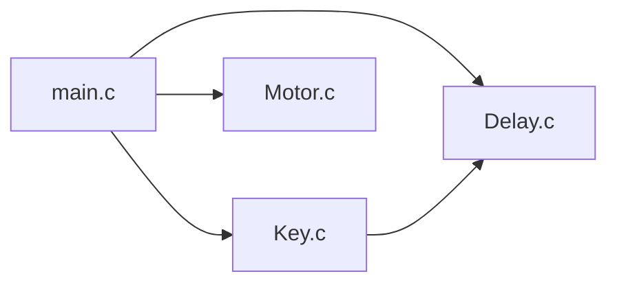
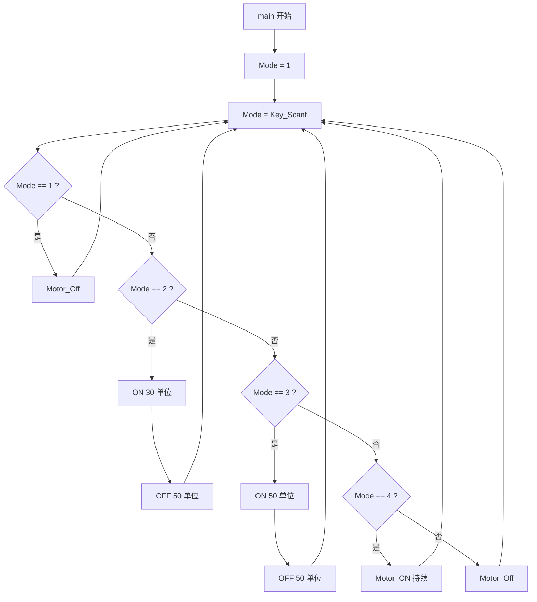

# 第 6 讲：直流电机

> **配套例程**：[51_Project/6Motor](../51_Project/6Motor/)
>
> **面向读者**：自动化与信息工程学院学生科学与技术协会大一成员
>
> **硬件平台**：普中 A2 开发板（主控 STC89C52RC，11.0592 MHz 晶振）
>
> **前置要求**：已完成[第 5 讲：蜂鸣器](05_蜂鸣器.md)，理解多文件工程、`Delay_10us` 与按键扫描。

这一讲用 4 个按键控制直流电机：

| 按键 | 功能 | 代码中的模式 |
| --- | --- | --- |
| K1 | 停止 | `Mode == 1` |
| K2 | 低速转动（约 30%） | `Mode == 2` |
| K3 | 中速转动（50%） | `Mode == 3` |
| K4 | 全速转动（100%） | `Mode == 4` |

从这一讲开始，程序要驱动**功率器件**了。电机和 LED、蜂鸣器最大的区别是：它电流大、有惯性、还是感性负载。所以本讲的重点有三个：

1. 为什么电机**不能直接接单片机引脚**；
2. 怎样用 **PWM（脉冲宽度调制）** 控制转速；
3. 为什么按键扫描里的 `static` 变量是电机能持续转动的关键。

## 目录

- [写在前面](#写在前面)
- [关于普中 A2](#关于普中-a2)
- [直流电机基础](#直流电机基础)
  - [为什么不能直接接引脚](#为什么不能直接接引脚)
  - [ULN2003 驱动](#uln2003-驱动)
  - [电机接线](#电机接线)
- [PWM 调速](#pwm-调速)
  - [平均电压](#平均电压)
  - [占空比与频率](#占空比与频率)
  - [软件 PWM](#软件-pwm)
- [工程结构](#工程结构)
- [Key 模块与 static](#key-模块与-static)
- [Motor 模块](#motor-模块)
- [main.c](#mainc)
  - [状态与动作](#状态与动作)
  - [PWM 的时间账](#pwm-的时间账)
  - [程序流程](#程序流程)
- [实验现象](#实验现象)
- [常见问题](#常见问题)
- [小结](#小结)

---

## 写在前面

建议你对着 Keil 打开配套工程，一边看代码一边读——**光看不敲是学不会单片机的**。

每个知识点后面如果标了 **⚠**，说明这是初学者最容易踩的坑。

> 📁 本讲完整代码已收录在本仓库：[51_Project/6Motor](../51_Project/6Motor/)
>
> 工程同样采用多文件结构：`main.c`、`Motor.c/h`、`Key.c/h`、`Delay.c/h`。

---

## 关于普中 A2

| 模块 | 连接方式 | 本讲是否用到 |
| --- | --- | --- |
| 直流电机接口 | 工程定义驱动引脚为 **P1.0**，经 ULN2003 驱动 | ✅ |
| 4 个独立按键 | K1→P3.1、K2→P3.0、K3→P3.2、K4→P3.3，另一端接 GND | ✅ |
| 晶振 | 11.0592 MHz | ✅ |

工程 `main.c` 开头有一行注释，写明了接线方式：

```c
// 将直流电机两根线接到开发板电机驱动部分的OUT1和5V上
```

也就是说：**电机的一端接 OUT1，另一端接 5V**。P1.0 驱动 ULN2003 的 IN1，IN1 控制 OUT1。

> ⚠ **动手前先断电。** 接电机线时不要把电源开着，避免电机突然转动打手或短路。

---

## 直流电机基础

### 为什么不能直接接引脚

有刷直流电机内部是线圈和换向器。给它两端加上直流电压，线圈产生磁场，转子就被推动旋转。它的两个关键特性决定了**不能直接用单片机引脚驱动**：

**① 电流大**

小型直流电机的空载电流就有几十毫安，堵转（用手捏住不让转）时可达几百毫安甚至超过 1 A。而 51 单片机单个引脚的安全电流只有 **10 ~ 20 mA**。

直接接上去的结果：轻则转速很慢、单片机发热，重则引脚永久损坏。

**② 感性负载会产生反向电动势**

电机线圈是电感。电感中的电流**不能突变**——当三极管或引脚突然关断时，线圈为了维持电流，会产生一个很高的反向电压（可能几十伏）：

```text
断电瞬间：
         ┌───────────────────┐
         │   线圈中的电流     │
         │   不能立刻消失     │
         └─────────┬─────────┘
                   │
                   ▼
        产生高压尖峰，可能击穿
        驱动管或单片机引脚
```

所以电机必须通过**驱动器件**控制，而且驱动器件要能承受大电流和反向电压。

### ULN2003 驱动

普中 A2 的电机驱动部分通常使用 **ULN2003**（具体以板子丝印和原理图为准）。它内部是 7 组**达林顿管**，可以把它理解成"7 个电流放大能力很强的开关"。

单个通道的结构（简化）：

```text
        电机电源 VCC
             │
           [电机]
             │
             ▼
        ┌─────────┐
        │  达林顿管 │  ← 集电极（OUT）
        └────┬────┘
             │
            GND

IN ── 基极电阻 ── 达林顿管基极
```

| ULN2003 特性 | 数值/说明 |
| --- | --- |
| 每通道最大灌电流 | 约 500 mA |
| 最大耐压 | 约 50 V |
| 输出形式 | 开漏（只负责把输出拉到 GND） |
| 输入电平 | 3.3 V / 5 V 逻辑可直接驱动 |
| 内部续流二极管 | 有（COM 引脚接电机电源） |

**关键：ULN2003 是反相驱动。**

| P1.0（IN1） | OUT1 | 电机（OUT1 与 5V 之间） |
| --- | --- | --- |
| 1（高） | 被拉到 GND | 导通，转动 |
| 0（低） | 高阻（悬空） | 无电流，停止 |

所以代码里 `Motor = 1;` 表示**转动**，`Motor = 0;` 表示**停止**——虽然 ULN2003 内部是反相的，但站在"电机转不转"的角度看，逻辑正好是直观的。

> ⚠ **续流二极管**：ULN2003 内部每个输出都带一个二极管，COM 引脚要接到电机电源（5V）。它的作用就是给电机断电瞬间的感应电流提供一条泄放回路，保护芯片。如果自己用分立三极管搭驱动，**必须**在电机两端反向并联一个续流二极管（如 1N4007），否则三极管很快会被击穿。

### 电机接线

按工程注释：

```text
   5V ──────── 电机一端
                电机
   OUT1 ────── 电机另一端
                 │
              ULN2003
                 ▲
              IN1 = P1.0
```

- 电机两根线接 **OUT1** 和 **5V**；
- 如果需要电机反转，把两根线对调即可（本项目只控制转速，不控制方向）；
- 电机转动方向与代码无关，只与接线极性有关。

> ⚠ 如果板子上有电机电源跳线，确认它已按丝印接好。电机不要接到 3.3V 或其他弱电源上。

---

## PWM 调速

### 平均电压

直流电机的转速近似与两端**平均电压**成正比。如果我们快速地"通电—断电—通电—断电"，电机由于**机械惯性**和**线圈电感**，感受到的是平均电压，而不是一次次通断。

```text
P1.0 输出：
     ┌────┐      ┌────┐      ┌────┐
     │ ON │ OFF  │ ON │ OFF  │ ON │ OFF
─────┘    └──────┘    └──────┘    └──────
     ←Ton→←Toff→
     ←──── T ────→
```

平均电压：

```text
Vavg = VCC × Ton / (Ton + Toff) = VCC × 占空比
```

- `Ton`：一个周期内导通的时间；
- `Toff`：一个周期内关断的时间；
- `T = Ton + Toff`：PWM 周期；
- 占空比 `D = Ton / T`。

### 占空比与频率

| 概念 | 公式 | 作用 |
| --- | --- | --- |
| 占空比 D | `Ton / (Ton + Toff)` | 决定平均电压，从而决定转速 |
| 频率 f | `1 / (Ton + Toff)` | 决定"通断的快慢" |

**频率不能太低**：如果周期长到电机能明显感觉到"转一下、停一下"，就会抖动、噪音大；
**频率也不能无限高**：驱动器件和单片机软件都跟不上，开关损耗增加。

小型直流电机常用的 PWM 频率大约在 **1 kHz ~ 20 kHz**。本工程约 1 kHz，正好在可听范围内，所以电机可能会发出轻微的"吱吱"声，这是正常的。

### 软件 PWM

51 没有专门的 PWM 外设，本工程用**软件延时**模拟：

```c
Motor_ON();
Delay_10us(30);   /* 导通 30 个时间单位 */
Motor_Off();
Delay_10us(50);   /* 关断 50 个时间单位 */
```

这就是一个 PWM 周期：先高电平一段时间，再低电平一段时间，不断重复。

> ⚠ **软件 PWM 的代价**：CPU 在这段时间里只能反复执行"翻转 + 延时"，不能做别的事。而且主循环里还要调用 `KEY_Scanf()`，扫描本身也会占用时间，导致实际占空比与计算值有偏差。
>
> 正式的电机控制会用**定时器硬件 PWM**：定时器自动输出方波，CPU 只需要设置占空比寄存器，完全不占用主循环。

---

## 工程结构

本工程和第 5 讲一样采用多文件结构：

```text
6Motor/
├── main.c        # 状态机：根据键码选择电机动作
├── Motor.c       # 电机驱动：ON / OFF
├── Motor.h
├── Key.c         # 按键扫描
├── Key.h
├── Delay.c       # 延时
├── Delay.h
├── STARTUP.A51
└── Motor.uvproj
```

模块调用关系：



`.h` / `.c` 的分工、头文件保护、如何在 Keil 中添加源文件，已在[第 5 讲](05_蜂鸣器.md#从单文件到多文件)详细讲过，本讲不再重复。

`Delay.c` 与第 5 讲完全相同：

```c
void Delay_10us(unsigned int ten_us)
{
    while(ten_us--);
}

void Delay_ms(unsigned int xms)
{
    unsigned int i, j;
    for(i = xms; i > 0; i--)
        for(j = 110; j > 0; j--);
}
```

`Delay_10us` 的逐句分析见[第 5 讲](05_蜂鸣器.md#delay-模块)。

---

## Key 模块与 static

`Key.c` 的扫描逻辑和第 3、5 讲一样，但返回值有一个关键变化：

```c
/* 调用头文件 */
#include "reg52.h"
#include "Delay.h"

/* 引脚定义 */
sbit KEY1 = P3^1;
sbit KEY2 = P3^0;
sbit KEY3 = P3^2;
sbit KEY4 = P3^3;


/**
  * @brief	按键扫描及处理
  * @param	无
  * @retval key_num 按下按键的编号
			0		没有按键被按下
			1		KEY1被按下
			2		KEY2被按下
			3		KEY3被按下
			4		KEY4被按下
*/
int KEY_Scanf(void)
{
	static unsigned char key_num = 1;	// 静态局部变量	
	KEY1 = 1;	// 51单片机读取引脚电平值，最好是先将对应引脚设置为高电平
	KEY2 = 1;
	KEY3 = 1;
	KEY4 = 1;
	if(KEY1 == 0)		/* KEY1 */
	{
		Delay_ms(10);	// 消抖
		if(KEY1 == 0)
		{
			key_num = 1;
		}
		while(KEY1 == 0);// 等待按键释放
	}
	else if(KEY2 == 0)		/* KEY2 */
	{
		Delay_ms(10);	// 消抖
		if(KEY2 == 0)
		{
			key_num = 2;
		}
		while(KEY2 == 0);// 等待按键释放
	}
	else if(KEY3 == 0)		/* KEY3 */
	{
		Delay_ms(10);	// 消抖
		if(KEY3 == 0)
		{
			key_num = 3;
		}
		while(KEY3 == 0);// 等待按键释放
	}
	else if(KEY4 == 0)		/* KEY4 */
	{
		Delay_ms(10);	// 消抖
		if(KEY4 == 0)
		{
			key_num = 4;
		}
		while(KEY4 == 0);// 等待按键释放
	}
	return key_num;
}
```

### 唯一的区别：`static`

第 5 讲蜂鸣器工程里是：

```c
unsigned char key_num = 0;        /* 普通局部变量 */
```

本讲是：

```c
static unsigned char key_num = 1; /* 静态局部变量 */
```

**`static` 修饰局部变量后，会发生三件事：**

| | 普通局部变量 | `static` 局部变量 |
| --- | --- | --- |
| 存储位置 | 栈 | 静态存储区（数据段） |
| 生命周期 | 函数返回即销毁 | 整个程序运行期间一直存在 |
| 初始化 | 每次调用都重新初始化 | **只在程序启动时初始化一次** |
| 作用域 | 函数内部 | 仍然是函数内部（外部看不见） |

**为什么电机工程必须用 `static`？**

主循环是这样的：

```c
while(1)
{
    Mode = Key_Scanf();
    if(Mode == 2) { /* PWM */ }
    ...
}
```

如果 `key_num` 是普通局部变量，那么每次调用 `Key_Scanf()`，只要没有按键，它就会重新变成 0。于是：

```text
第 1 次循环：按 K2 → 返回 2 → 电机转一个 PWM 周期
第 2 次循环：没按键 → 返回 0 → else 分支 → Motor_Off
第 3 次循环：没按键 → 返回 0 → Motor_Off
……
```

结果就是：**松手之后电机立刻停**。按键只在你按着的那一瞬间有效。

改成 `static` 之后：

```text
第 1 次循环：按 K2 → key_num = 2 → 返回 2 → 电机运行
第 2 次循环：没按键 → key_num 保持 2 → 返回 2 → 电机继续运行
第 3 次循环：没按键 → 仍然返回 2 → 电机继续运行
```

**一次按键，模式被"记住"了。** 这就是 `static` 的意义：它让函数拥有了"记忆"。

> ⚠ **`static` 的初始化只执行一次。** 虽然 `static unsigned char key_num = 1;` 这行代码写在函数里，但它**不会**在每次调用时都执行。程序启动时 `key_num` 被初始化为 1，之后每次进入函数都直接沿用上一次的值。初学者最容易误以为它每次都会变回 1。

### 为什么初值是 1

```c
static unsigned char key_num = 1;
```

上电后第一次调用 `KEY_Scanf()` 时，如果没有任何按键，函数返回 1，`main` 进入 `Mode == 1` 分支，执行 `Motor_Off()`。

也就是说：**上电默认电机停止**，符合安全直觉。

如果初值写成 2，上电后电机会直接以低速转起来，这显然不是我们想要的。

### 返回类型

```c
int KEY_Scanf(void);
```

函数返回 `int`，但内部变量是 `unsigned char`。赋值和返回时会发生整型提升，值 0 ~ 4 不受影响。写成 `unsigned char` 返回值会更贴切，但 `int` 也能正常工作。

---

## Motor 模块

```c
/* 调用头文件 */
#include "reg52.h"
#include "Delay.h"

/* 引脚定义 */
sbit Motor = P1^0;

/**
  * @brief	关闭电机
  * @param	无
  * @retval	无
*/
void Motor_Off(void)
{
	Motor = 0;
}


/**
  * @brief	电机转动
  * @param	无
  * @retval	无
*/
void Motor_ON(void)
{
	Motor = 1;
}
```

### 引脚定义

```c
sbit Motor = P1^0;
```

P1.0 接 ULN2003 的 IN1。注意这里用的是 **P1**，不是前面 LED、按键用的 P2/P3：

| 模块 | 引脚 |
| --- | --- |
| LED | P2.0 ~ P2.7 |
| 按键 | P3.0 ~ P3.3 |
| 蜂鸣器 | P2.5 |
| 电机驱动 | P1.0 |

> ⚠ 不同开发板、不同批次的引脚可能不同，永远以原理图和你手上的工程为准。

### Motor_ON / Motor_Off

这两个函数非常简单，只是给 P1.0 赋 1 或 0：

- `Motor_ON()` → `P1.0 = 1` → ULN2003 的 OUT1 拉低 → 电机两端有压差 → 转动；
- `Motor_Off()` → `P1.0 = 0` → OUT1 悬空 → 无电流 → 停止。

`Motor.c` 包含了 `Delay.h`，但函数体里并没有调用延时。这是从模板复制过来的残留，无害，但可以删掉。

> 💡 **为什么不在 `Motor.c` 里直接写 PWM？**
>
> 因为 `Motor.c` 的职责是"控制电机的通断"，而"通多久、断多久"是**控制策略**，属于 `main`。这样拆分后，以后要换成定时器 PWM，只需要改 `main`（或新增一个 PWM 模块），`Motor.c` 一行都不用动。

---

## main.c

```c
/* 调用头文件 */
// 将直流电机两根线接到开发板电机驱动部分的OUT1和5V上
#include "reg52.h"
#include "Key.h"
#include "Motor.h"
#include "Delay.h"


/**
  * @brief	主函数
  * @param	无
  * @retval	无
*/
int main(void)
{
	unsigned char Mode = 1;		/* 状态变量 */
	while(1)
	{
		Mode = Key_Scanf();
		if(Mode == 1)			/* 状态1：电机关闭 */
		{
			Motor_Off();
		}
		else if(Mode == 2)		/* 状态2：电机30%转速 */
		{
			Motor_ON();
			Delay_10us(30);	/* 约等价1KHz 30%占空比PWM */
			Motor_Off();
			Delay_10us(50);
		}
		else if(Mode == 3)		/* 状态3：电机50%转速 */
		{
			Motor_ON();
			Delay_10us(50);	/* 约等价1KHz 50%占空比PWM */
			Motor_Off();
			Delay_10us(50);
		}
		else if(Mode == 4)		/* 状态4：电机100%转速 */
		{
			Motor_ON();		/* 约等价1KHz 100%占空比PWM */
		}
		else					/* 其余：电机关闭 */
		{
			Motor_Off();
		}
	}
}
```

### 状态与动作

| Mode | 来源 | 动作 | 实际效果 |
| --- | --- | --- | --- |
| 1 | K1 | `Motor_Off()` | 停止 |
| 2 | K2 | ON 30 单位 + OFF 50 单位 | 低速 |
| 3 | K3 | ON 50 单位 + OFF 50 单位 | 中速 |
| 4 | K4 | `Motor_ON()` | 全速 |
| 其他 | — | `Motor_Off()` | 停止 |

`Mode` 初始化为 1，但下一行 `Mode = Key_Scanf();` 会立刻覆盖它。这个初值其实**没有实际作用**，保留只是表达"默认停止"的意图。

### PWM 的时间账

先按 `Delay_10us(1) ≈ 10 μs` 估算：

**Mode 2（代码注释称"30%"）**

```text
Ton  = Delay_10us(30) ≈ 300 μs
Toff = Delay_10us(50) ≈ 500 μs
T    = 300 + 500 = 800 μs
f    = 1 / 800 μs = 1250 Hz
D    = 300 / 800 = 37.5%
```

**Mode 3（代码注释称"50%"）**

```text
Ton  = 500 μs
Toff = 500 μs
T    = 1000 μs
f    = 1000 Hz
D    = 50%
```

**Mode 4（100%）**

```text
Motor 一直为 1，没有关断时间
D = 100%
```

> ⚠ **注释和代码有两处不一致，要心里有数：**
>
> 1. **频率**：只有 50% 那档是 1 kHz；30% 那档周期是 800 μs，频率约 1.25 kHz。
> 2. **占空比**：30 单位导通、50 单位关断，实际占空比是 `30/80 = 37.5%`，不是 30%。如果想得到真正的 30%，应该让 `Ton:Toff = 30:70`，例如 `Delay_10us(30)` + `Delay_10us(70)`。
>
> 这和第 2 讲 `Delay_ms` 的注释问题一样：**代码能跑，注释不能全信**。读别人的代码时，一定要自己算一遍。

**实际占空比还会更低。** 因为每个 PWM 周期结束后，主循环还要调用一次 `Key_Scanf()`：

```text
一次主循环 = PWM 周期 + 按键扫描开销 + 分支判断开销
```

`Key_Scanf()` 会置高 4 个引脚、做 4 次比较，即使没有按键也要几十个机器周期。这段时间里电机是关断的，所以：

```text
实际占空比 = Ton / (Ton + Toff + 扫描开销) < 计算值
```

另外，`Delay_10us` 的实际单位可能大于 10 μs（见第 5 讲分析），所以真实频率会比计算值低一些。这些偏差对"能看出快慢"的演示来说完全够用，但**不能用它做精确调速**。

### 程序流程



注意 Mode 2 和 Mode 3 的分支里**只执行一个 PWM 周期**就回到循环顶部，而不是在分支里死循环输出 PWM。这样做的好处是：每输出一个周期就能重新扫描一次按键，按键响应不会太迟钝。

### 按住按键时会发生什么

`Key_Scanf()` 里有 `while(KEYx == 0);` 等待释放。按住按键期间：

- 程序卡在 `while` 里，**不会执行 PWM 输出**；
- P1.0 保持上一次写入的状态；
- 如果上一次是 `Motor_Off()`，电机停转；如果上一次是 Mode 4 的 `Motor_ON()`，电机会全速转动。

所以操作时建议**按一下就松开**，不要长按。

---

## 实验现象

上电后：

1. `Mode` 初值 1，`KEY_Scanf` 返回 1（`static` 初值），电机停止；
2. 按下并松开 **K2**：电机以低速持续转动；
3. 按下并松开 **K3**：转速变快（中速）；
4. 按下并松开 **K4**：全速转动；
5. 按下并松开 **K1**：停止。

| 按键 | 转速感受 | 声音 |
| --- | --- | --- |
| K1 | 停 | 无 |
| K2 | 慢 | 可能有轻微 PWM 啸叫 |
| K3 | 中 | 啸叫略变 |
| K4 | 最快 | 主要是电机本身的转动声 |

> 💡 由于 `static` 记住了模式，**松手后电机会一直保持当前转速**，直到你按另一个键。这正是我们想要的行为，也是本讲 `static` 的作用所在。

> ⚠ **电机启动瞬间电流较大**，如果开发板由电脑 USB 供电，可能会看到 LED 变暗、数码管闪烁，甚至单片机复位。这是电源被电机拉低导致的。条件允许时给电机驱动部分单独供电，并在电源端并联大电容。

---

## 常见问题

### 1. 电机完全不转

按顺序排查：

1. **接线**：电机两根线是否分别接到 OUT1 和 5V（按工程注释）；
2. **跳线**：电机驱动模块的电源/信号跳线是否按丝印连接；
3. **ULN2003**：芯片是否插反、是否发热（发热说明可能接错或短路）；
4. **引脚**：工程用 P1.0，确认硬件走线一致；
5. **模式**：是否停在 Mode 1（停止），按 K2/K3/K4 试试；
6. **电源**：5V 是否正常，USB 供电是否带得动电机。

### 2. 电机只抖动、不转

- 占空比太低，启动转矩不够；
- 电源电压不足或内阻太大；
- 电机轴被卡住。

可以先按 K4 全速试试，判断是驱动问题还是 PWM 问题。

### 3. 转速不随按键变化

- 电机可能被直接接到了 5V，绕过了 ULN2003；
- 检查 `KEY_Scanf` 是否被正确调用，`static key_num` 是否生效；
- 用万用表/示波器看 P1.0 是否有 PWM 波形。

### 4. 按 K1 停不下来

- 检查 K1 是否真的接到 P3.1；
- 在 `Mode == 1` 分支里加一个断点，看是否进入；
- 确认 `Motor_Off()` 里写的是 `Motor = 0`。

### 5. 电机一转，单片机就复位

电源问题。电机启动电流把 5V 拉低，触发单片机掉电复位。解决办法：

- 使用独立电源给电机供电（共地）；
- 电源端加大电容（如 470 μF ~ 1000 μF）；
- 避免用电流能力弱的 USB 口。

### 6. 编译报 `UNRESOLVED EXTERNAL SYMBOL`

`Motor.c` 或 `Key.c` 没有加入 Keil 工程。见[第 5 讲](05_蜂鸣器.md#在-keil-中添加源文件)。

---

## 小结

| 知识点 | 出现在哪里 |
| --- | --- |
| 电机为什么不能直接接引脚 | 为什么不能直接接引脚 |
| 感性负载与反向电动势 | 为什么不能直接接引脚 |
| ULN2003 达林顿驱动与续流二极管 | ULN2003 驱动 |
| 电机接线与转向 | 电机接线 |
| 平均电压与占空比 | PWM 调速 |
| PWM 频率的选择 | 占空比与频率 |
| 软件 PWM 的实现与代价 | 软件 PWM |
| `static` 局部变量 | Key 模块与 static |
| 状态保持与模式记忆 | Key 模块与 static |
| 注释与代码不一致的核对 | PWM 的时间账 |
| 主循环中扫描与输出交替执行 | 程序流程 |

**到这里，51 单片机的基础例程就告一段落了。** 你已经接触了：

- GPIO 输出（LED、蜂鸣器、电机）；
- GPIO 输入（按键、消抖）；
- 位运算与端口操作；
- 多文件模块化编程；
- 软件延时与软件 PWM。

下一步值得学习的内容：

1. **定时器与中断**——替代软件延时，实现精确计时和硬件 PWM；
2. **串口通信**——让单片机和电脑、其他模块交换数据；
3. **数码管与 LCD**——显示信息；
4. **ADC / I2C / SPI**——连接更多传感器。

**练习建议**：

1. 把 Mode 2 改成真正的 30%：`Delay_10us(30)` + `Delay_10us(70)`；
2. 增加一个"更慢"的档位，比如 10%；
3. 把 `static` 去掉，观察松手后电机是否立刻停止，理解它的作用；
4. 思考：如果要把 PWM 频率提高到 10 kHz，`Delay_10us` 的参数应该怎么改？软件 PWM 还能做到吗？

学习过程中遇到问题，欢迎在预备成员群里提问，或者直接私信学长学姐。
