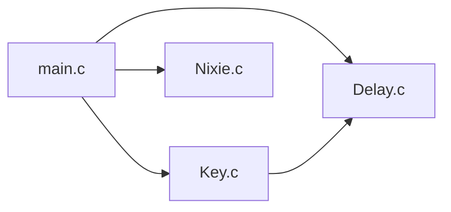

# 第 7 讲：矩阵按键

> **配套例程**：[51_Project/7MatrixKey](../51_Project/7MatrixKey/)
>
> **面向读者**：自动化与信息工程学院学生科学与技术协会大一成员
>
> **硬件平台**：普中 A2 开发板（主控 STC89C52RC，11.0592 MHz 晶振）
>
> **前置要求**：已完成[第 4 讲：数码管](04_数码管.md)，理解动态扫描、段码表与多文件工程；了解[第 3 讲](03_按键控制LED.md)的独立按键消抖逻辑。

第 3 讲用 4 个独立按键分别控制 4 个 LED，需要 4 个 GPIO。如果要做 16 键的矩阵键盘，用独立按键的思路要 16 个引脚——51 单片机总共才 32 个 I/O，根本不够用。

这一讲的核心就是把按键**编组成矩阵**：用 8 根线管理 16 个按键，同时把按键的编号映射成数码管要显示的数字或字母。从"一个引脚管一个键"到"行列复用"，是 GPIO 输入效率的一次质变。

**本讲功能**：

| 操作 | 显示效果 |
| --- | --- |
| 按下矩阵按键 1~10 | 数码管从右到左依次填入 `0` ~ `9` |
| 按下矩阵按键 11~16 | 数码管从右到左依次填入 `A` ~ `F` |
| 输入超过 8 位 | 最左位被丢弃，其余位左移，新数字出现在最右位 |

## 目录

- [写在前面](#写在前面)
- [关于普中 A2](#关于普中-a2)
- [矩阵键盘原理](#矩阵键盘原理)
  - [为什么用矩阵](#为什么用矩阵)
  - [行扫描：驱动一行、读四列](#行扫描驱动一行读四列)
  - [按键编号的计算](#按键编号的计算)
- [数码管显示缓冲区](#数码管显示缓冲区)
  - [右对齐与左移溢出](#右对齐与左移溢出)
  - [按键到数字的映射](#按键到数字的映射)
- [工程结构](#工程结构)
- [Key 模块](#key-模块)
- [main.c](#mainc)
- [实验现象](#实验现象)
- [常见问题](#常见问题)
- [从第 4 讲到第 7 讲](#从第-4-讲到第-7-讲)
- [小结](#小结)

---

## 写在前面

建议你对着 Keil 打开配套工程，一边看代码一边读——**光看不敲是学不会单片机的**。

每个知识点后面如果标了 **⚠**，说明这是初学者最容易踩的坑。

> 📁 本讲完整代码已收录在本仓库：[51_Project/7MatrixKey](../51_Project/7MatrixKey/)
>
> 工程由 `main.c`、`Key.c/h`、`Nixie.c/h`、`Delay.c/h` 共 7 个源文件组成，可直接用 Keil 打开 `.uvproj` 编译烧录。

做本实验前，先确认两件事：

- 矩阵键盘的排线是否接在 P1 口（普中 A2 上矩阵键盘默认接 P1）；
- 数码管位选跳线是否接在 74HC138 一侧（同第 4 讲的要求）。

---

## 关于普中 A2

本讲用到的硬件：

| 模块 | 连接方式 | 本讲是否用到 |
| --- | --- | --- |
| 4×4 矩阵键盘 | 行接 P1.7 ~ P1.4，列接 P1.3 ~ P1.0 | ✅ |
| 8 位数码管 | 共阴极；段选接 P0，位选经 74HC138 由 P2.2~P2.4 控制 | ✅ |
| 74HC138 | 3-8 译码器，位选 | ✅ |
| 晶振 | 11.0592 MHz | ✅ |

> ⚠ **矩阵键盘的 16 个按键按下的检测逻辑和独立按键不同。** 独立按键是一端接 GPIO、一端接 GND，按下直接读到 0；矩阵键盘的行和列**都接在 GPIO 上**，需要通过"逐行拉低、读列状态"的方式判断哪个键被按下。

---

## 矩阵键盘原理

### 为什么用矩阵

4 个独立按键需要 4 个引脚。如果有 16 个按键，用独立按键的思路需要 16 个引脚。但把它们排成 4 行 × 4 列的矩阵，**只需要 4 + 4 = 8 个引脚**：

```text
         列1(P1.3)   列2(P1.2)   列3(P1.1)   列4(P1.0)
            │          │          │          │
行1(P1.7) ─┼─[S1 ]────┼─[S2 ]────┼─[S3 ]────┼─[S4 ]──
            │          │          │          │
行2(P1.6) ─┼─[S5 ]────┼─[S6 ]────┼─[S7 ]────┼─[S8 ]──
            │          │          │          │
行3(P1.5) ─┼─[S9 ]────┼─[S10]────┼─[S11]────┼─[S12]──
            │          │          │          │
行4(P1.4) ─┼─[S13]────┼─[S14]────┼─[S15]────┼─[S16]──
            │          │          │          │
```

每个按键跨接在一根行线和一根列线上。按下时，对应的行和列**直接导通**。

- **行（Row）**：本工程接 P1.7 ~ P1.4，作为**输出**，扫描时逐行拉低；
- **列（Col）**：本工程接 P1.3 ~ P1.0，作为**输入**，配合内部弱上拉，默认读到 1。

> ⚠ 用 P1 口的高 4 位做行、低 4 位做列，是方便代码里做"读端口整体值"的判断。如果你自己接线时用了不同引脚，`KEY_PORT` 的宏和移位量要跟着改。

### 行扫描：驱动一行、读四列

矩阵键盘不能像独立按键那样一次性读所有键——如果同时把 4 行都拉低，任何一个键按下都会让对应列变低，你只知道"有某一列被按了"，但不知道是**哪一行**的。

正确做法是**逐行扫描**：

```text
Step 1: 拉低第 1 行（P1.7 = 0），其余三行置高，读 4 列
        → 如果 S1 被按下：P1.7 和 P1.3 导通 → 读到 P1.3 = 0 → 按键是 (第1行, 第1列)
        → 如果 S2 被按下：P1.7 和 P1.2 导通 → 读到 P1.2 = 0 → 按键是 (第1行, 第2列)

Step 2: 拉低第 2 行（P1.6 = 0），其余三行置高，读 4 列
        → 同理判断第 2 行的 4 个键

Step 3: 拉低第 3 行，读 4 列
Step 4: 拉低第 4 行，读 4 列
```

扫描流程：

```text
开始
  │
  ├─ 全部行拉低、列置高 → 读 P1
  │    │
  │    ├─ 读回 ≠ 0x0F？——否→ 无键按下，返回 0
  │    │
  │    └─ 是 → 消抖 10ms → 再次确认
  │              │
  │              └─ 逐行扫描（i = 0~3）：
  │                    │
  │                    拉低第 i 行，读 4 列
  │                    │
  │                    ├─ COL1 = 0 → key = i×4 + 1
  │                    ├─ COL2 = 0 → key = i×4 + 2
  │                    ├─ COL3 = 0 → key = i×4 + 3
  │                    └─ COL4 = 0 → key = i×4 + 4
  │
  └─ 等待按键释放 → 松开消抖 → 返回 key
```

代码中对应的实现：

```c
KEY_PORT = 0x0F;                     // 行全低、列全高
if(KEY_PORT != 0x0F)                 // 读回 ≠ 写入 → 有键按下
{
    Delay_ms(10);                    // 消抖
    if(KEY_PORT != 0x0F)             // 二次确认
    {
        for(row = 0; row < 4; row++)
        {
            KEY_PORT = ~(0x80 >> row);  // 逐行拉低：P1.7→P1.6→P1.5→P1.4
            if(KEY_COL1 == 0) { key_num = row * 4 + 1; break; }
            else if(KEY_COL2 == 0) { key_num = row * 4 + 2; break; }
            else if(KEY_COL3 == 0) { key_num = row * 4 + 3; break; }
            else if(KEY_COL4 == 0) { key_num = row * 4 + 4; break; }
        }
        KEY_PORT = 0x0F;             // 恢复全行低，准备检测释放
        while(KEY_PORT != 0x0F);     // 等待释放
        Delay_ms(10);                // 松开消抖
    }
}
```

### 按键编号的计算

扫描到第 `row` 行（0~3）、第 `col` 列（1~4）时，按键编号为：

```text
key_num = row × 4 + col
```

| row | col=1（P1.3） | col=2（P1.2） | col=3（P1.1） | col=4（P1.0） |
| --- | --- | --- | --- | --- |
| 0（P1.7） | key=1（S1） | key=2（S2） | key=3（S3） | key=4（S4） |
| 1（P1.6） | key=5（S5） | key=6（S6） | key=7（S7） | key=8（S8） |
| 2（P1.5） | key=9（S9） | key=10（S10） | key=11（S11） | key=12（S12） |
| 3（P1.4） | key=13（S13） | key=14（S14） | key=15（S15） | key=16（S16） |

> ⚠ **这个编号取决于你的行/列接线顺序。** 如果你把行接到了 P1.0~P1.3、列接到了 P1.4~P1.7，那编号会完全不同。代码里的移位量（`0x80 >> row`）和索引计算公式（`row * 4 + col`）必须和硬件接线对应，不能直接照抄。

---

## 数码管显示缓冲区

### 右对齐与左移溢出

本讲不是按一下键直接在某一位显示——而是维护一个**长度为 8 的显示缓冲区** `disp_buf[8]`，每次按键都把新数字"推入"最右端，已有数字依次左移：

```text
按下第 1 个键 "1"：
  disp_buf: [  ][  ][  ][  ][  ][  ][  ][ 1]    数码管: ______1

按下第 2 个键 "2"：
  disp_buf: [  ][  ][  ][  ][  ][  ][ 1][ 2]    数码管: _____12

按下第 3 个键 "3"：
  disp_buf: [  ][  ][  ][  ][  ][ 1][ 2][ 3]    数码管: ____123

……持续输入，直到 8 位填满……

按下第 8 个键 "8"：
  disp_buf: [ 1][ 2][ 3][ 4][ 5][ 6][ 7][ 8]    数码管: 12345678

按下第 9 个键 "9"：
  disp_buf: [ 2][ 3][ 4][ 5][ 6][ 7][ 8][ 9]    数码管: 23456789
                                                  ↑ 最左的 "1" 被丢弃
```

实现上就是一次数组左移 + 最右位赋值：

```c
for(i = 0; i < 7; i++)
{
    disp_buf[i] = disp_buf[i+1];   // 左移
}
disp_buf[7] = smgd_code[digit];    // 新数字在最右位
```

### 按键到数字的映射

| 按键编号 | 1~10 | 11 | 12 | 13 | 14 | 15 | 16 |
| --- | --- | --- | --- | --- | --- | --- | --- |
| 显示内容 | `0`~`9` | `A` | `B` | `C` | `D` | `E` | `F` |

映射关系非常直接：`digit = key_num - 1`，然后 `smgd_code[digit]` 取段码。

---

## 工程结构

```text
7MatrixKey/
├── main.c          # 主函数、段码表、显示缓冲区和刷新逻辑
├── Key.c           # 矩阵按键扫描
├── Key.h           # 按键模块函数声明
├── Nixie.c         # 数码管驱动（位选 + 段选）
├── Nixie.h         # 数码管模块函数声明
├── Delay.c         # 延时函数
├── Delay.h         # 延时模块函数声明
├── STARTUP.A51     # 启动代码
└── MatrixKey.uvproj  # Keil 工程文件
```

模块调用关系：



`Nixie.c/h` 和 `Delay.c/h` 与第 4 讲完全相同，本讲直接复用。新增的是 `Key.c/h`。

---

## Key 模块

`Key.h`：

```c
#ifndef __KEY_H
#define __KEY_H

/* 函数声明 */
unsigned char MatrixKey_Scan(void);

#endif
```

`Key.c`（完整代码）：

```c
/* 调用头文件 */
#include "reg52.h"
#include "Delay.h"

/* 引脚定义 */
#define KEY_PORT P1		// 4x4矩阵键盘接P1口
sbit KEY_ROW1 = P1^7;	// 第1行
sbit KEY_ROW2 = P1^6;	// 第2行
sbit KEY_ROW3 = P1^5;	// 第3行
sbit KEY_ROW4 = P1^4;	// 第4行
sbit KEY_COL1 = P1^3;	// 第1列
sbit KEY_COL2 = P1^2;	// 第2列
sbit KEY_COL3 = P1^1;	// 第3列
sbit KEY_COL4 = P1^0;	// 第4列


/**
  * @brief	矩阵按键扫描：检测是否有按键被按下，返回按键编号
  * @param	无
  * @retval	key_num  按键编号（1~16）
  			0         没有按键被按下
*/
unsigned char MatrixKey_Scan(void)
{
	unsigned char key_num = 0;
	unsigned char row;

	/* 逐行扫描 */
	KEY_PORT = 0x0F;					// 列置高、行置低，准备读列状态

	/* 判断是否有键按下：检查任一列是否为低 */
	if(KEY_PORT != 0x0F)
	{
		Delay_ms(10);					// 消抖
		if(KEY_PORT != 0x0F)			// 确认有键按下
		{
			/* 逐行驱动为低，读取列状态 */
			for(row = 0; row < 4; row++)
			{
				KEY_PORT = ~(0x80 >> row);	// 行(P1.7~P1.4)逐行置低，其余行置高，列置高
				if(KEY_COL1 == 0)
				{
					key_num = row * 4 + 1;
					break;
				}
				else if(KEY_COL2 == 0)
				{
					key_num = row * 4 + 2;
					break;
				}
				else if(KEY_COL3 == 0)
				{
					key_num = row * 4 + 3;
					break;
				}
				else if(KEY_COL4 == 0)
				{
					key_num = row * 4 + 4;
					break;
				}
			}
			/* 等待按键释放 */
			KEY_PORT = 0x0F;			// 重新拉低所有行，准备检测释放
			while(KEY_PORT != 0x0F);
			Delay_ms(10);				// 松开消抖
		}
	}

	return key_num;
}
```

### 逐句讲解

#### 初始化扫描：`KEY_PORT = 0x0F`

```c
KEY_PORT = 0x0F;    // 0x0F = 0000 1111
```

- 高 4 位（行 P1.7~P1.4）写 0 → 四行全部拉低；
- 低 4 位（列 P1.3~P1.0）写 1 → 四列置高（配合内部上拉）。

全部行拉低的目的：只要**任意**一个键被按下，对应的列就会被对应的行拉到低电平，`KEY_PORT` 读回来的值就不再是 `0x0F`。这是一种"粗检测"——快速判断有没有键被按，而不需要逐行扫。

> ⚠ 如果读回来等于 `0x0F`，说明没有键按下，直接返回 0。不满足条件时整个 `if` 块跳过，函数耗时几乎为零。

#### 消抖

```c
if(KEY_PORT != 0x0F)
{
    Delay_ms(10);                // 消抖
    if(KEY_PORT != 0x0F)         // 二次确认
```

和第 3 讲独立按键完全一样的"延时 + 二次确认"结构。矩阵键盘的机械触点同样会抖。

#### 逐行扫描：`~(0x80 >> row)`

```c
KEY_PORT = ~(0x80 >> row);
```

| row | `0x80 >> row` | `~(0x80 >> row)` 二进制 | 效果 |
| --- | --- | --- | --- |
| 0 | 0x80 | `0111 1111` | P1.7 = 0，其余 = 1 |
| 1 | 0x40 | `1011 1111` | P1.6 = 0，其余 = 1 |
| 2 | 0x20 | `1101 1111` | P1.5 = 0，其余 = 1 |
| 3 | 0x10 | `1110 1111` | P1.4 = 0，其余 = 1 |

`0x80`（即 `1000 0000`）的 bit 7 刚好对应 P1.7。右移 `row` 位后取反，就把对应行拉低、其余三行置高、四列全部置高。这样做的效果是：

- **只有当前被扫描的行是低电平**，其余行全是高电平；
- 如果当前行上某个键被按下了，对应的列就会被拉低（因为行和列通过按键导通）；
- 其余行都是高电平，它们上面的键即使被按下，也不会把列拉低（因为按键两端都是高电平，没有电流通路）。

这就是逐行扫描能"定位到具体哪一个键"的原因。

#### 列判断与编号计算

```c
if(KEY_COL1 == 0)      { key_num = row * 4 + 1; break; }
else if(KEY_COL2 == 0) { key_num = row * 4 + 2; break; }
else if(KEY_COL3 == 0) { key_num = row * 4 + 3; break; }
else if(KEY_COL4 == 0) { key_num = row * 4 + 4; break; }
```

找到第一个为 0 的列就用 `break` 跳出 `for` 循环——一次扫描只返回一个按键，这和第 3 讲用 `else if` 限制"一次最多处理一个按键"是同一思路。

#### 等待释放

```c
KEY_PORT = 0x0F;             // 重置：全部行拉低
while(KEY_PORT != 0x0F);     // 等待按键释放
Delay_ms(10);                // 松开消抖
```

`for` 循环结束后 `KEY_PORT` 里还留着最后一次"只拉低一行"的值，必须先重置为 `0x0F`（全部行拉低），再去判断释放。否则 `while(KEY_PORT != 0x0F)` 可能因为保留值不对而直接跳过或死等。

---

## main.c

完整代码：

```c
/* 调用头文件 */
#include "reg52.h"
#include "Key.h"
#include "Nixie.h"
#include "Delay.h"

/* 变量定义 */
unsigned char smgd_code[16]={0x3f,0x06,0x5b,0x4f,0x66,0x6d,0x7d,0x07,
							0x7f,0x6f,0x77,0x7c,0x39,0x5e,0x79,0x71};	// 共阴极数码管0~F段码表

unsigned char disp_buf[8] = {0};	// 显示缓冲区（位置8在左，位置1在右）


/**
  * @brief	按键处理：编号→段码→填入显示缓冲区（右对齐，左移溢出）
  * @param	key_num  按键编号（1~16）
  * @retval	无
*/
void Key_Process(unsigned char key_num)
{
	unsigned char i;
	unsigned char digit;

	if(key_num == 0) return;	// 无按键按下，直接返回

	digit = key_num - 1;		// 按键1→0, 按键2→1, …, 按键16→F

	/* 显示缓冲区左移（最右位空出，最左位丢弃） */
	for(i = 0; i < 7; i++)
	{
		disp_buf[i] = disp_buf[i+1];
	}
	disp_buf[7] = smgd_code[digit];	// 新数字放在最右位
}


/**
  * @brief	数码管动态扫描：将显示缓冲区内容刷新一次
  * @param	无
  * @retval	无
*/
void Display_Buffer(void)
{
	unsigned char i;
	for(i = 0; i < 8; i++)
	{
		SMG_Display(i+1, disp_buf[i]);	// 按位发送显示数据
		Delay_ms(5);					// 等待显示稳定
		SMG_Display(i+1, 0x00);		// 清空段选（消隐）
	}
}


/**
  * @brief	主函数
  * @param	无
  * @retval	无
*/
int main(void)
{
	unsigned char key;

	while(1)
	{
		key = MatrixKey_Scan();		// 扫描矩阵按键
		Key_Process(key);			// 更新显示缓冲区
		Display_Buffer();			// 刷新数码管显示
	}
}
```

### 主循环的三个动作

主循环每次迭代做三件事：

```text
MatrixKey_Scan()  →  Key_Process()  →  Display_Buffer()
   扫描按键            更新缓冲区           刷新数码管
```

`MatrixKey_Scan()` 在没有按键按下时几乎是瞬间返回 0，`Key_Process(0)` 也是直接 `return`，所以大部分时间都花在 `Display_Buffer()` 的动态扫描上（约 8 × 5 ms = 40 ms 一轮）。

> ⚠ **按键必须按下并释放后，显示才会更新。** `MatrixKey_Scan()` 在检测到按键后会卡在 `while(KEY_PORT != 0x0F)` 等释放——按着不松手的话，数码管会停在当前显示内容不动，也不会响应其他按键。这和第 3 讲独立按键的 `while(KEYx == 0)` 是同一行为。

---

## 实验现象

烧录后，你会看到：

1. **上电初始**：8 位数码管全部不亮（显示缓冲区全为 `0x00`，即全灭）。
2. **按下按键 1**：最右边一位数码管显示 `0`。
3. **依次按下 1、2、3**：数码管从右到左依次显示 `0`、`1`、`2`。
4. **按下按键 11**：数码管新添一位 `A`。
5. **持续输入超过 8 位**：最左边的数字被丢弃，新的数字挤入最右端。比如依次输入 1~9，最终显示 `23456789`（`1` 被丢弃）。
6. **按下按键 16**：新添一位 `F`。

---

## 常见问题

### 1. 按下按键后数码管没反应

按顺序排查：

1. 矩阵键盘排线是否插在 P1 口；
2. 数码管位选跳线是否接到 74HC138 一侧；
3. 用万用表测 P1 口各引脚，确认按键按下时行和列是否导通；
4. 如果接线顺序和代码不一致（比如行接到了低 4 位、列接到了高 4 位），`~(0x80 >> row)` 这一行要跟着改。

### 2. 数码管总是显示上一次的内容，不更新

`MatrixKey_Scan()` 在没有按键时返回 0，`Key_Process(0)` 直接返回，缓冲区不变，显示自然不变。这是正常行为——**按键按下并释放后**才会更新。

### 3. 某个按键按下后数码管显示一个不认识的字符

按键编号到数字的映射是 `digit = key_num - 1`。如果你的矩阵键盘丝印编号和代码假设的不一致，映射就会错。解决方法是先写一个测试程序：按一个键，让数码管显示这个键的编号（`key_num` 本身），确认编号对不对，再改映射。

### 4. 同时按两个键，只识别了一个

本工程的扫描逻辑每次只返回第一个检测到的按键（`break` 立即跳出），不支持多键同时按下。这是教学代码的简化设计。实际产品中的矩阵键盘如果要支持组合键，需要更复杂的扫描逻辑或者加二极管防止"鬼键"。

### 5. 数码管闪烁或有重影

和第 4 讲的问题一样——消隐没做好。确认 `SMG_Display(i+1, 0x00)` 在每次 `Delay_ms(5)` 之后都执行了。

### 6. 按键按下时数码管不刷新

`MatrixKey_Scan()` 里的 `while(KEY_PORT != 0x0F)` 会阻塞主循环，数码管停在当前显示的最后一帧。按键释放后数码管才会更新。这不是 bug，而是阻塞式扫描的固有行为。

---

## 从第 4 讲到第 7 讲

| 方面 | 第 4 讲 | 第 7 讲 |
| --- | --- | --- |
| 输入方式 | 无（纯输出） | 矩阵键盘（4×4，8 线管 16 键） |
| 显示内容 | 固定显示 1~8 | 按输入动态更新 |
| 数据结构 | 每次循环直接写 `smgd_code[i]` | 维护 8 位显示缓冲区，左移更新 |
| 模块数量 | main + Nixie + Delay | main + Nixie + Delay **+ Key** |
| 消抖逻辑 | 无 | 在矩阵扫描内部完成，对 main 透明 |
| 核心新知识 | 段码、位选、动态扫描 | 行列扫描、显示缓冲区、键值映射 |

**模块化的持续演进**：第 4 讲把 Delay 和 Nixie 拆了出去；这一讲新增 Key 模块后，`main.c` 更薄了——它只关心"按键事件来了之后，缓冲区怎么变、数码管怎么亮"，底层硬件细节（矩阵怎么扫、位选怎么设）都和它无关。

**仍然存在的阻塞问题**：`MatrixKey_Scan()` 在等待按键释放时会卡住整个程序，数码管在这期间不刷新。这个问题的根源是"扫描 + 等待"耦合在了一起。学了定时器中断之后，可以把扫描交给定时器周期性执行，按键状态用标志位通知主循环，彻底解耦。

---

## 小结

| 知识点 | 出现在哪里 |
| --- | --- |
| 矩阵键盘的行列复用原理（8 线 → 16 键） | 为什么用矩阵 |
| 逐行扫描的流程（拉低一行、读四列） | 行扫描 |
| `0x80 >> row` 的移位控制 | 逐行扫描：~(0x80 >> row) |
| 按键编号计算 `row × 4 + col` | 按键编号的计算 |
| 消抖 + 二次确认在矩阵场景中的用法 | 逐句讲解 |
| 显示缓冲区的左移更新与溢出丢弃 | 右对齐与左移溢出 |
| 按键编号到十六进制数字的映射 | 按键到数字的映射 |
| 多模块工程的结构与分工 | 工程结构 |
| 矩阵键盘的阻塞特性与影响 | 常见问题 |

**下一讲**：[第 8 讲：外部中断 0](08_外部中断0.md)——在流水灯的基础上引入硬件中断，按下按键触发 ISR，体会"CPU 暂停当前工作去响应外部事件"的机制。

**练习建议**：

1. 把逐行扫描时 `0x80 >> row` 改成 `0x01 << row`，看看按键编号会变成什么样，理解移位方向的重要性；
2. 修改映射规则：让按键 1~8 直接显示 1~8，按键 9~16 显示 A~H（需要扩充段码表）；
3. 把数码管显示方向反过来（左对齐、右移），比如输入的序列从左边开始显示；
4. 让按下按键时蜂鸣器响一声（提示：在 `Key_Process` 里加蜂鸣器控制）。

学习过程中遇到问题，欢迎在预备成员群里提问，或者直接私信学长学姐。